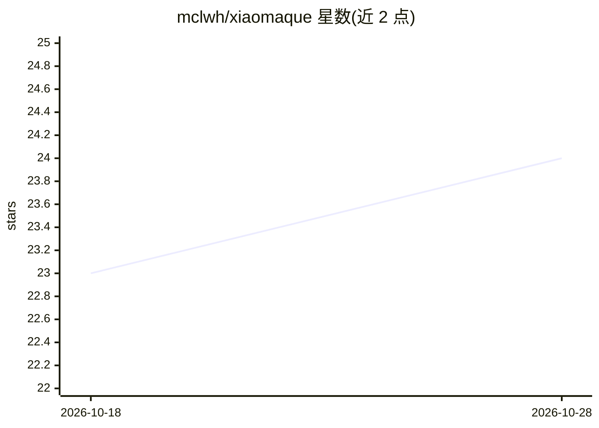

# mclwh/xiaomaque

⭐ 24 · TypeScript · MIT · 推送 2026-06-29 · [GitHub](https://github.com/mclwh/xiaomaque) · 个人维护 · 中文 README

**短剧/漫剧 AI 创作平台：剧本生成、分镜编辑与 AI 生图生视频**

面向短剧与视频创作者的自托管 Web 平台：从创意输入出发，用基于 LangChain 的 Agent 生成剧本摘要与分集正文，在资产库管理角色、场景、道具，通过分镜编辑器调用火山方舟 Seedream 生图与 Seedance 生视频，并配 React Flow 无限画布（自述可用但仍在优化）。前后端分离（React 19 + Express），需 Node.js≥18、pnpm≥8、MySQL 8.x 与火山方舟 API Key，本地方运行。仿小云雀实现。

## 筛选速览

| 维度 | 判定 | 备注 |
|---|---|---|
| AI 角色 | `ai-native` | 本体是模型或模型工具 |
| 许可风险 | `permissive` | MIT |
| 部署形态 | `library` | 以包/库形式分发 |
| 模型依赖 | — | README 未给出锁定关系 |
| 硬件要求 | — | 无带数字的原话,不猜 |
| 安装摩擦 | `low` | 无编译、无系统依赖或容器化 |
| 成熟度 | `idea` | |

## 能力要点

- Agent 生成结构化剧本摘要与影视格式分集正文
- 分镜片段编辑、@资产引用与时长标记
- 集成火山方舟 Seedream 生图与 Seedance 生视频
- 基于 React Flow 的多媒体无限画布与跨项目资产库

## 适用场景

- 从一句创意出发生成完整短剧剧本与分集脚本
- 在分镜编辑器中逐镜生成图片和视频素材
- 跨项目复用角色、场景、道具资产

## 场景标签

`视频生成` `图像生成` `AI 写作` · 领域:内容生成

## 证据(README 行号)

> L3: 小麻雀是一款面向短剧与视频创作的 AI 辅助平台。用户可以从创意灵感出发，借助大语言模型生成剧本摘要与分集脚本，在可视化画布中管理角色、场景等资产，并通过分镜编辑与 AI 生图、生视频能力，完成从策划到成片的全流程创作。
> L24: - 集成火山方舟 Seedream 生图、Seedance 生视频
> L41: |剧本摘要|将创意/大纲转为结构化剧本摘要，供立项与编剧使用|

## 星数曲线

2026-10-18 23 → 2026-10-28 24（+1）

---
*卡片 v1 · prompt 1.4 · 生成 2026-10-27 · 置信度 mid · 依据 README sha `7602b3a32bf3` · [字段定义](../../DATASET.md)*
