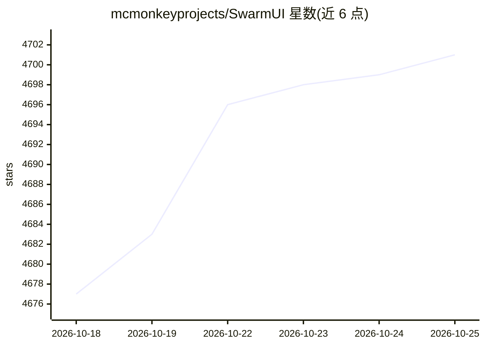

# mcmonkeyprojects/SwarmUI

⭐ 4,703 · C# · MIT · 推送 2026-10-21 · [GitHub](https://github.com/mcmonkeyprojects/SwarmUI) · 个人维护

**面向 Stable Diffusion 等模型的模块化 AI 图像生成 Web 界面**

SwarmUI（前称 StableSwarmUI）是基于 .NET 的 AI 图像/视频/音频生成 Web 用户界面：内置 Generate 标签页供直接生成，提供 Comfy Workflow 图编辑、网格生成器、图像编辑器与自动工作流生成等工具；可自动安装 ComfyUI 作为后端，或选用 AUTOMATIC1111 webui 作为后端。支持多 GPU 并行（swarm）为同一用户生成图像。支持 SD/Flux/Krea 2 等图像模型、Wan/LTX-2 等视频模型及 ACE-Step 等音频模型。提供 Windows 安装脚本、Linux/macOS 脚本、Docker 与 Colab 方式运行；项目自述处于 Almost-Release/Beta 状态。

## 筛选速览

| 维度 | 判定 | 备注 |
|---|---|---|
| AI 角色 | `ai-native` | 本体是模型或模型工具 |
| 许可风险 | `permissive` | MIT |
| 部署形态 | `desktop` | 安装包/桌面程序 |
| 模型依赖 | — | README 未给出锁定关系 |
| 硬件要求 | — | 无带数字的原话,不猜 |
| 安装摩擦 | `medium` | 含编译或系统依赖之一 |
| 成熟度 | `idea` | |

## 能力要点

- Generate 标签页直接生成 + Comfy Workflow 原始图编辑两种模式
- 支持多 GPU 并行为同一用户生成图像（swarm 命名来源）
- 可自动安装 ComfyUI 后端，或接入 AUTOMATIC1111 webui 后端
- 覆盖图像（SD/Flux/Krea 2）、视频（Wan/LTX-2）、音频（ACE-Step）模型

## 适用场景

- 在浏览器中生成与管理 AI 图像，兼顾新手与进阶工作流
- 用网格生成器、图像编辑器等工具批量探索参数
- 聚合多张 GPU 加速批量生成

## 场景标签

`图像生成` `视频生成` `语音合成` · 领域:内容生成

## 证据(README 行号)

> L7: A Modular AI Image Generation Web-User-Interface, with an emphasis on making powertools easily accessible, high perf
> L20: Beginner users will love Swarm's primary Generate tab interface, making it easy to generate anything with a variety

## 星数曲线

2026-10-18 4,677 → 2026-10-25 4,701（+24）

---
*卡片 v1 · prompt 1.4 · 生成 2026-10-21 · 置信度 high · 依据 README sha `3183b124eb8f` · [字段定义](../../DATASET.md)*
