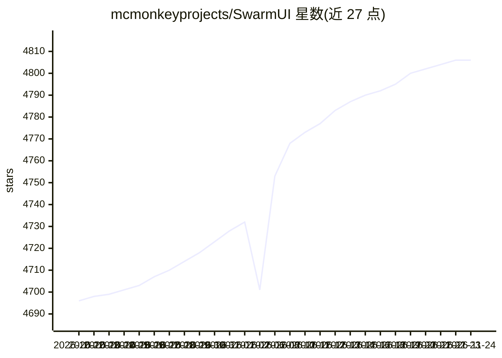

# mcmonkeyprojects/SwarmUI

⭐ 4,806 · C# · MIT · 推送 2026-11-22 · [GitHub](https://github.com/mcmonkeyprojects/SwarmUI) · 个人维护

**模块化 Stable Diffusion 图像生成 WebUI，本地运行**

前身为 StableSwarmUI 的模块化 AI 图像/视频生成 Web 界面，支持 Stable Diffusion、Flux、Wan 等模型。提供 Generate 标签页的便捷生成界面，高级用户可用 Comfy Workflow 原始节点图；内置图像编辑器、Grid Generator 等工具，可多 GPU 并行生成同一任务。后端支持自动安装 ComfyUI 或 A1111 WebUI，通过 .NET 8 运行，提供 Windows/Linux/Mac 安装脚本与 Docker 部署方式，Mac 仅限 Apple Silicon。

## 筛选速览

| 维度 | 判定 | 备注 |
|---|---|---|
| AI 角色 | `ai-native` | 本体是模型或模型工具 |
| 许可风险 | `permissive` | MIT |
| 部署形态 | `desktop` | 安装包/桌面程序 |
| 模型依赖 | — | README 未给出锁定关系 |
| 硬件要求 | — | 无带数字的原话,不猜 |
| 安装摩擦 | `medium` | 含编译或系统依赖之一 |
| 成熟度 | `idea` | |

## 能力要点

- 支持图像（Stable Diffusion/Flux/Krea）、视频（Wan/LTX-2）与音频（ACE-Step）模型
- Generate 便捷界面与 Comfy Workflow 原始节点图两种使用模式
- 可自动安装 ComfyUI 或 AUTOMATIC1111 后端
- 多 GPU 同时生成（swarm 命名由来）

## 适用场景

- 本地搭建 WebUI 进行 Stable Diffusion 图像生成
- 在多 GPU 机器上并行跑大网格生成任务
- 需要同时使用便捷界面和 Comfy 原始工作流

## 场景标签

`图像生成` `视频生成` · 领域:内容生成

## 证据(README 行号)

> L7: A Modular AI Image Generation Web-User-Interface, with an emphasis on making powertools easily accessible, high perf
> L20: Beginner users will love Swarm's primary Generate tab interface, making it easy to generate anything with a variety
> L142: The "Swarm" name is in reference to the original key function of the UI: enabling a 'swarm' of GPUs to all generat

## 星数曲线

2026-10-22 4,696 → 2026-11-24 4,806（+110）

---
*卡片 v1 · prompt 1.4 · 生成 2026-11-22 · 置信度 high · 依据 README sha `8053b3d4b459` · [字段定义](../../DATASET.md)*
