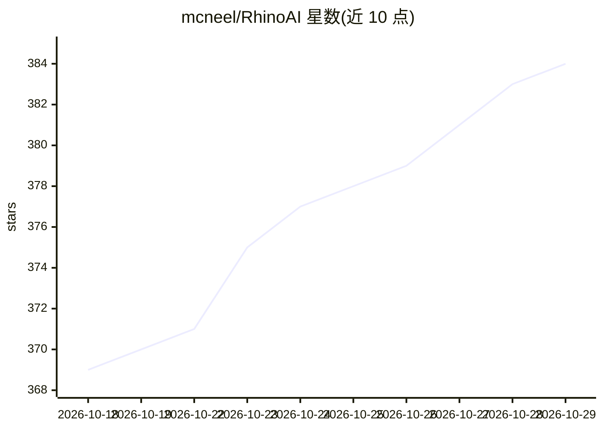

# mcneel/RhinoAI

⭐ 384 · C# · MIT · 推送 2026-10-28 · [GitHub](https://github.com/mcneel/RhinoAI) · [官网](https://mcneel.github.io/RhinoAI/) · 组织维护

**为 Rhino3D 提供 MCP 集成，接入 AI 助手操控建模**

McNeel 官方维护的 Rhino3D AI 集成：以 Rhino MCP 服务器为核心，让 Claude Desktop、Claude Code、GitHub Copilot、OpenAI Codex、Gemini CLI 或本地模型等 AI 助手连接并操作 Rhino。最快路径是安装 Rhino3d connector，由其自动安装 Rhino 插件；开发者可在 VSCode 中一键构建、启动 Rhino 并启动 MCP Server 进行调试。文档托管于 GitHub Pages，含入门、示例与开发者指南。

## 筛选速览

| 维度 | 判定 | 备注 |
|---|---|---|
| AI 角色 | `ai-ecosystem` | LLM/agent 周边工具 |
| 许可风险 | `permissive` | MIT |
| 部署形态 | `None` |  |
| 模型依赖 | — | README 未给出锁定关系 |
| 硬件要求 | — | 无带数字的原话,不猜 |
| 安装摩擦 | `low` | 无编译、无系统依赖或容器化 |
| 成熟度 | — | 结构信号不足 |

## 能力要点

- Rhino MCP 服务器连接 AI 助手与 Rhino3D
- 支持 Claude Desktop / Claude Code / Copilot / Codex / Gemini CLI / 本地模型等多种助手
- Rhino3d connector 可自动安装 Rhino 插件
- VSCode 一键构建、启动 Rhino 并启动 MCP Server

## 适用场景

- 在 Rhino 建模流程中通过 AI 助手下发指令
- 把 Rhino 纳入支持 MCP 的 AI 助手工作流
- 在开发周期中用 Rhino MCP 构建自定义集成

## 场景标签

 · 领域:CAD/设计工具 AI 集成

## 证据(README 行号)

> L5: **An AI Integration for Rhino3d**
> L13: - Getting Started - Install the plugin and wire up an AI assistant (Claude Desktop, Claude Code, GitHub Copilot, Op

## 星数曲线

2026-10-18 369 → 2026-10-29 384（+15）

---
*卡片 v1 · prompt 1.4 · 生成 2026-10-21 · 置信度 high · 依据 README sha `4612a2e55948` · [字段定义](../../DATASET.md)*
