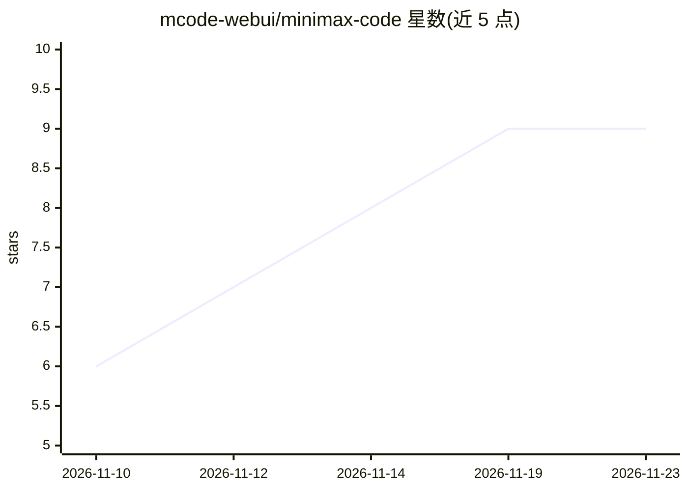

# mcode-webui/minimax-code

⭐ 9 · TypeScript · MIT · 推送 2026-11-21 · [GitHub](https://github.com/mcode-webui/minimax-code) · [官网](https://code.minimax.cn/docs/community/webui) · 组织维护 · 中文 README

**面向开发者的浏览器端编码 Agent 工作台，本地运行**

MiniMax Code 的 WebUI 分支：本地服务器加浏览器界面，用户选择项目文件夹、用自然语言描述任务，由 Agent 检查项目、编辑文件、运行命令和测试，界面内聚合对话、文件、diff、终端与预览面板。支持 MiniMax 账号登录或自带模型（openai-completions、openai-responses、anthropic-messages 格式的自定义 provider），保留上游 TUI、headless CLI 与 ACP 源码。通过 npm 全局安装运行，默认监听 127.0.0.1:2233，支持局域网访问与定时任务。模型调用可能产生费用。

## 筛选速览

| 维度 | 判定 | 备注 |
|---|---|---|
| AI 角色 | `ai-ecosystem` | LLM/agent 周边工具 |
| 许可风险 | `permissive` | MIT |
| 部署形态 | `library` | 以包/库形式分发 |
| 模型依赖 | — | README 未给出锁定关系 |
| 硬件要求 | — | 无带数字的原话,不猜 |
| 安装摩擦 | `low` | 无编译、无系统依赖或容器化 |
| 成熟度 | — | 结构信号不足 |

## 能力要点

- 浏览器工作台集成对话、文件、diff、终端与预览面板
- 支持 MiniMax 账号或自定义 provider（openai/anthropic 兼容格式）
- 支持插件、Skills、MCP 服务器与 Mini Apps 扩展
- 定时任务、subagents、会话导入与远程设备访问

## 适用场景

- 让 Agent 定位失败测试、修复实现并运行验证
- 在浏览器中审查文件改动与工具执行过程
- 在局域网其他设备上访问本地开发工作台

## 场景标签

`编码 Agent` `代码审查` · 领域:编码与开发

## 证据(README 行号)

> L17: Choose a project folder, describe a task, and follow the agent's work in one browser workspace. Keep the conversati
> L23: **A browser interface with a local runtime.** The server runs on your computer or a machine you manage; the browser
> L57: For your own model, open **Settings → Usage & models → Custom models**, add a provider, enter its endpoint and API 

## 星数曲线

2026-11-10 6 → 2026-11-23 9（+3）

---
*卡片 v1 · prompt 1.4 · 生成 2026-11-20 · 置信度 high · 依据 README sha `355b665505a5` · [字段定义](../../DATASET.md)*
