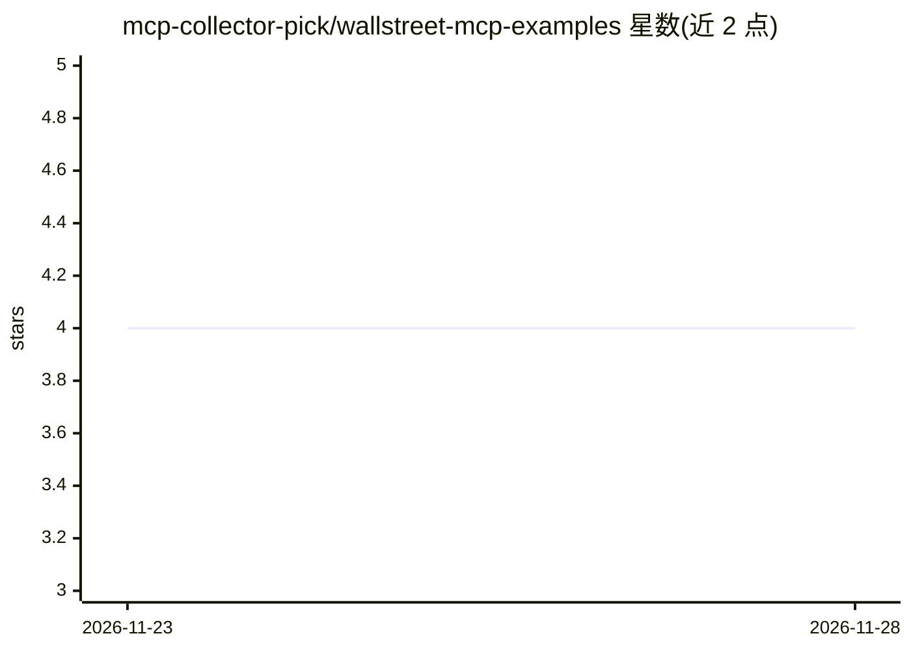

# mcp-collector-pick/wallstreet-mcp-examples

⭐ 4 · Python · MIT · 推送 2026-11-22 · [GitHub](https://github.com/mcp-collector-pick/wallstreet-mcp-examples) · [官网](https://apify.com/mcp_collector) · 组织维护

**把 90+ 量化引擎经 MCP 接入 Claude Desktop 等 AI 客户端的示例集**

为 Wall Street MCP Suite 提供的示例与快速上手文档：通过 Model Context Protocol 将 60-90 余个量化与宏观引擎接入 Claude Desktop、Cursor、Windsurf、ChatGPT、LangChain、CrewAI 等客户端。引擎在服务端预计算 60 项量化指标并返回确定性结果，接入方式含 JSON 配置、SSE 远程 MCP、pip 安装的 Python SDK（wallstreet-mcp-tools）及自动化脚本示例；使用需 Apify token。

## 筛选速览

| 维度 | 判定 | 备注 |
|---|---|---|
| AI 角色 | `ai-knowledge` | 知识聚合/清单类 |
| 许可风险 | `permissive` | MIT |
| 部署形态 | `library` | 以包/库形式分发 |
| 模型依赖 | — | README 未给出锁定关系 |
| 硬件要求 | — | 无带数字的原话,不猜 |
| 安装摩擦 | `low` | 无编译、无系统依赖或容器化 |
| 成熟度 | — | 结构信号不足 |

## 能力要点

- 提供 Claude Desktop/Cursor/ChatGPT 等 6 种客户端的接入配置示例
- pip 可安装的官方 Python SDK（wallstreet-mcp-tools）
- 含自动化量化研究脚本示例（每日筛选器、CrewAI 三代理团队、异常监控）
- 88 个量化引擎目录按趋势/宏观/资金流等类别列出

## 适用场景

- 在 Claude Desktop 里对个股运行 360° 量化审计
- 用 LangChain/CrewAI 搭建每日自动量化筛选流程
- 让 AI 代理使用预计算的财务指标而非自行估算

## 场景标签

`Agent 框架` `金融量化` · 领域:Agent 开发

## 证据(README 行号)

> L12: Ready-to-use examples for connecting **90+ institutional-grade quantitative & macro engines** to Claude Desktop, Cu
> L30: This MCP suite **pre-computes all 60 quantitative indicators** server-side and streams only the deterministic resul
> L103: ### Option F: Python SDK (`pip install wallstreet-mcp-tools`)

## 星数曲线

2026-11-23 4 → 2026-11-28 4（+0）

---
*卡片 v1 · prompt 1.4 · 生成 2026-11-23 · 置信度 high · 依据 README sha `53f7ed513d35` · [字段定义](../../DATASET.md)*
