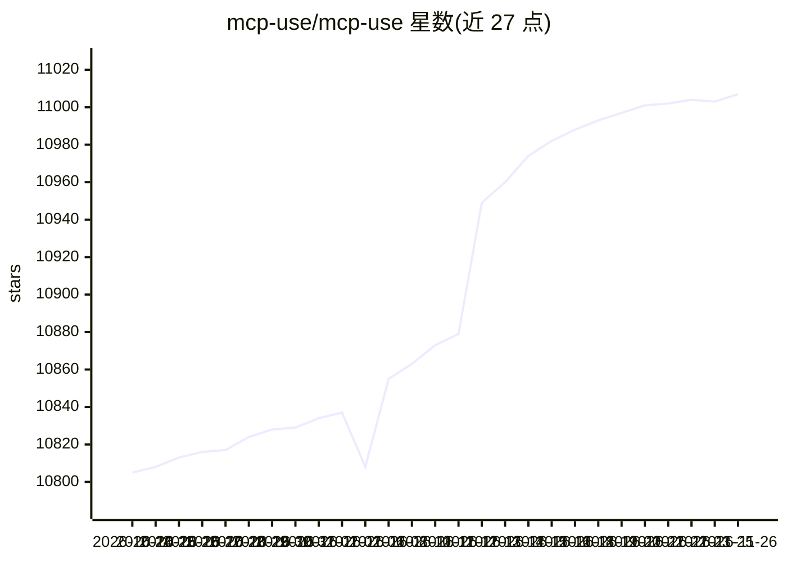

# mcp-use/mcp-use

⭐ 11,007 · TypeScript · MIT · 推送 2026-11-25 · [GitHub](https://github.com/mcp-use/mcp-use) · [官网](https://manufact.com) · 组织维护

**TypeScript MCP 全栈框架：为开发者构建 MCP 服务器与应用**

基于官方 TypeScript SDK v2 构建的 MCP 开发框架，用于构建、测试与部署 MCP 服务器、ChatGPT 插件与 Claude connectors。核心机制包括：Zod schema 贯穿工具到结构化结果的类型系统、React Views 直接绑定工具的 MCP Apps 支持、内置 Inspector 浏览器/CLI 调试、agent-first 无头工作流与 tunnel 公网测试。通过 create-mcp-use-app 脚手架生成项目，可部署到 Manufact 或按指南自托管，另提供 Python 版本。MIT 许可。

## 筛选速览

| 维度 | 判定 | 备注 |
|---|---|---|
| AI 角色 | `ai-ecosystem` | LLM/agent 周边工具 |
| 许可风险 | `permissive` | MIT |
| 部署形态 | `library` | 以包/库形式分发 |
| 模型依赖 | — | README 未给出锁定关系 |
| 硬件要求 | — | 无带数字的原话,不猜 |
| 安装摩擦 | `low` | 无编译、无系统依赖或容器化 |
| 成熟度 | — | 结构信号不足 |

## 能力要点

- Zod schema 从工具到结构化结果、View props 的全链路类型化
- React Views 绑定工具，生成 ChatGPT 会话内交互式 MCP App
- 内置 Inspector：浏览器与 CLI 无头两种调试路径，含截图验证
- 官方 SDK v2 之上增加 Views、无状态运行时、CLI 与部署流程

## 适用场景

- 为 AI Agent 开发 MCP 服务器并本地调试
- 在 ChatGPT 中构建带交互界面的插件扩展
- 用 CLI 无头调用工具并截图验证 View 输出
- 部署 MCP 服务并获取可观测性与评测数据

## 场景标签

`Agent 框架` · 领域:Agent 开发

## 证据(README 行号)

> L5:  The TypeScript framework for MCP
> L177: mcp-use builds on the official TypeScript SDK v2 and adds first-class Views, typed tool-to-UI contracts, an optimi

## 星数曲线

2026-10-24 10,805 → 2026-11-26 11,007（+202）

---
*卡片 v1 · prompt 1.4 · 生成 2026-11-22 · 置信度 high · 依据 README sha `1b9f27a8d2e9` · [字段定义](../../DATASET.md)*
