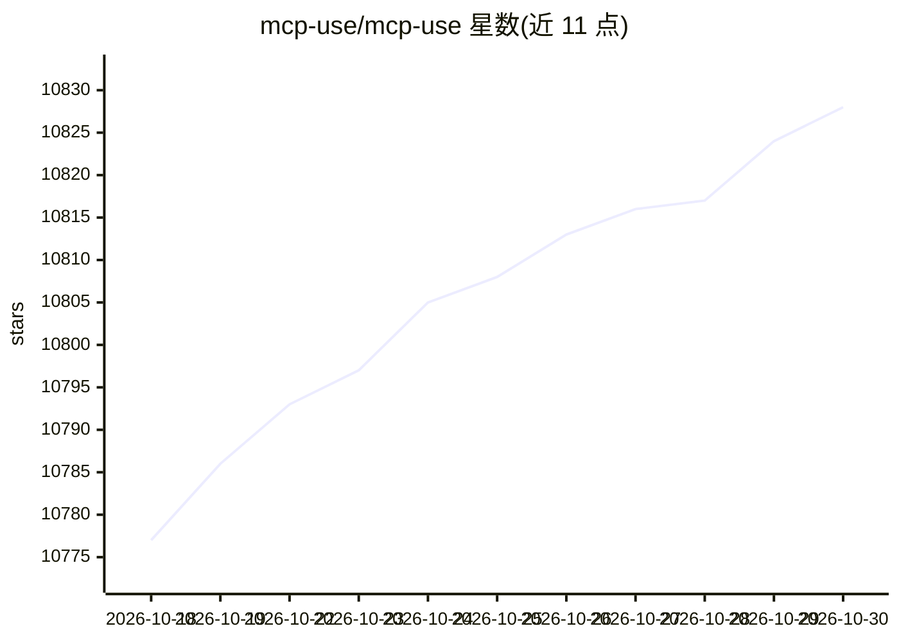

# mcp-use/mcp-use

⭐ 10,828 · TypeScript · MIT · 推送 2026-10-29 · [GitHub](https://github.com/mcp-use/mcp-use) · [官网](https://manufact.com) · 组织维护

**TypeScript 全栈 MCP 框架：构建 MCP 服务器与 MCP Apps**

用于构建、测试与部署 MCP 服务器、ChatGPT 插件与 Claude connectors 的 TypeScript 框架，基于官方 TypeScript SDK v2，提供全类型定义、绑定 React Views 的工具、内置 Inspector 调试、无头 CLI 验证与截图、隧道公网测试及部署流程。通过 npx create-mcp-use-app 脚手架初始化项目。生态包含客户端、agent、inspector、tunnel 等包，另有 Python 版本。由 manufact.com 维护，MIT 许可。

## 筛选速览

| 维度 | 判定 | 备注 |
|---|---|---|
| AI 角色 | `ai-ecosystem` | LLM/agent 周边工具 |
| 许可风险 | `permissive` | MIT |
| 部署形态 | `library` | 以包/库形式分发 |
| 模型依赖 | — | README 未给出锁定关系 |
| 硬件要求 | — | 无带数字的原话,不猜 |
| 安装摩擦 | `low` | 无编译、无系统依赖或容器化 |
| 成熟度 | — | 结构信号不足 |

## 能力要点

- Zod 类型从工具贯穿到结构化结果与 React View 属性
- 内置 Inspector 与无头 CLI 的工具调用与 View 截图验证
- React Views 直接绑定工具，构建 MCP Apps 交互界面
- 隧道功能为本地 MCP 服务器生成公网 URL 供测试

## 适用场景

- 为 ChatGPT/Claude 构建 MCP 服务器与 MCP Apps
- 在浏览器中调试并验证 MCP 工具与交互视图
- 通过 agent/CLI 工作流脚手架化、调用与部署 MCP 项目

## 场景标签

`Agent 框架` · 领域:Agent 开发

## 证据(README 行号)

> L5:  The TypeScript framework for MCP
> L154: mcp-use builds on the official TypeScript SDK v2 and adds first-class Views, typed tool-to-UI contracts, an optimi

## 星数曲线

2026-10-18 10,777 → 2026-10-30 10,828（+51）

---
*卡片 v1 · prompt 1.4 · 生成 2026-10-20 · 置信度 high · 依据 README sha `229616bfd610` · [字段定义](../../DATASET.md)*
