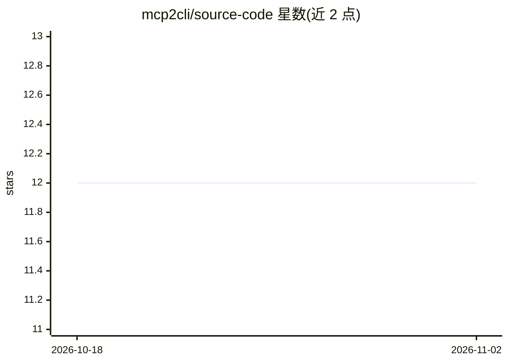

# mcp2cli/source-code

⭐ 12 · Rust · Apache-2.0 · 推送 2026-09-21 · [GitHub](https://github.com/mcp2cli/source-code) · [官网](https://mcp2cli.dev) · 组织维护

**将 MCP 服务器自动转换为可发现、可脚本化 CLI 工具的适配器**

Rust 编写的命令行适配器：连接任意 MCP 服务器后自动发现其工具、资源与提示词，依据 JSON Schema 生成带类型校验的 clap 命令树（工具变子命令、字段变 --flags）。支持 Streamable HTTP 与 Stdio 两种传输、MCP 2025-11-25 与 2026-07-28 双版本协议、命名配置与符号链接别名、Profile 覆盖层重命名/隐藏/分组命令、JSON 结构化输出、守护进程保持连接、后台任务与事件系统。面向 MCP 服务器开发者与运维者，可用于测试、E2E 一致性验证、CI/CD 编排与 AI agent 工具调用。通过 cargo install 从源码安装。

## 筛选速览

| 维度 | 判定 | 备注 |
|---|---|---|
| AI 角色 | `ai-ecosystem` | LLM/agent 周边工具 |
| 许可风险 | `permissive` | Apache-2.0 |
| 部署形态 | `library` | 以包/库形式分发 |
| 模型依赖 | — | README 未给出锁定关系 |
| 硬件要求 | — | 无带数字的原话,不猜 |
| 安装摩擦 | `low` | 无编译、无系统依赖或容器化 |
| 成熟度 | — | 结构信号不足 |

## 能力要点

- 从 MCP 服务器能力自动生成带类型校验的 CLI 命令树（JSON Schema → --flags）
- 支持 MCP 2025-11-25 与 2026-07-28 双版本协议，自动探测回退
- 每条命令支持 --json 结构化输出，供脚本与 AI agent 解析
- Profile 覆盖层可在不改服务器的情况下重命名、隐藏、分组命令

## 适用场景

- 在终端直接调用 MCP 服务器工具而无需 JSON-RPC 客户端代码
- 为 MCP 服务器做健康检查与端到端一致性测试
- 在 CI/CD 流水线中以 JSON 输出与退出码编排 MCP 操作
- AI agent 通过 shell 与结构化输出调用任意 MCP 工具

## 场景标签

 · 领域:MCP/开发者工具

## 证据(README 行号)

> L3: **Turn any MCP server into a native command-line application.**
> L18: MCP (Model Context Protocol) defines a powerful standard for servers to expose tools, resources, and prompts. But i
> L253: |**AI agent tool-use**|`--json` output → parse in Python/Node → agents call any MCP tool|

## 星数曲线

2026-10-18 12 → 2026-11-02 12（+0）

---
*卡片 v1 · prompt 1.4 · 生成 2026-11-01 · 置信度 mid · 依据 README sha `ec3c04813b81` · [字段定义](../../DATASET.md)*
