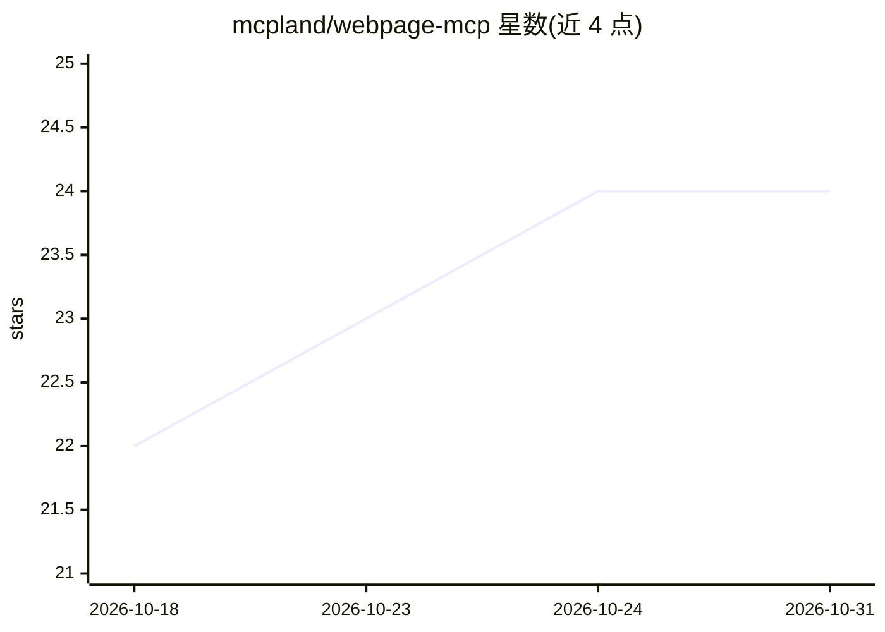

# mcpland/webpage-mcp

⭐ 24 · TypeScript · MIT · 推送 2026-10-14 · [GitHub](https://github.com/mcpland/webpage-mcp) · 组织维护

**把现有网页/浏览器暴露为 MCP 服务器，供 AI 客户端控制**

由 Chrome 扩展（Webpage MCP Connector）与 MCP 服务器组成：通过 Chrome Native Messaging 与本地 IPC 将浏览器能力（导航、截图、点击、读取内容、网络抓包、执行 JS 等 20+ 工具）以 MCP 工具形式提供给 Claude、Cursor、Windsurf、Codex 等 MCP 客户端。默认 stdio 本地传输，可选经认证的 Streamable HTTP 网关服务远程客户端。支持工作流录制/回放、跨标签语义搜索（本地向量库+Hugging Face 模型下载）、应用至代码的可视化编辑。面向在真实用户浏览器配置上做 agent 自动化的开发者。

## 筛选速览

| 维度 | 判定 | 备注 |
|---|---|---|
| AI 角色 | `ai-ecosystem` | LLM/agent 周边工具 |
| 许可风险 | `permissive` | MIT |
| 部署形态 | `library` | 以包/库形式分发 |
| 模型依赖 | — | README 未给出锁定关系 |
| 硬件要求 | — | 无带数字的原话,不猜 |
| 安装摩擦 | `low` | 无编译、无系统依赖或容器化 |
| 成熟度 | — | 结构信号不足 |

## 能力要点

- Chrome 扩展 + MCP 服务器架构，通过 Native Messaging 暴露 20+ 浏览器工具
- 复用用户已打开的 Chrome 与登录态，不另起自动化浏览器
- 工作流录制/发布/触发/回放，可发布为 MCP 工具
- 内置向量数据库的跨标签语义搜索（本地推理）

## 适用场景

- 让 Claude/Cursor 等 MCP 客户端控制我已登录的真实浏览器完成任务
- 把常用浏览器操作录制成可复用、可被 agent 调用的工作流
- 在多个标签页间做语义搜索定位内容

## 场景标签

`浏览器自动化` `语义搜索` · 领域:效率与自动化

## 证据(README 行号)

> L13:  Let AI assistants like Claude, Cursor, Windsurf, Codex, and other MCP-compatible clients control your webpage — na
> L24: The **Webpage MCP Connector** (Chrome extension) exposes real browser capabilities as MCP tools. The **MCP Server**
> L18: ┌──────────────┐  MCP stdio (default)    ┌────────────────────┐

## 星数曲线

2026-10-18 22 → 2026-10-31 24（+2）

---
*卡片 v1 · prompt 1.4 · 生成 2026-10-27 · 置信度 high · 依据 README sha `e4e381c56a41` · [字段定义](../../DATASET.md)*
