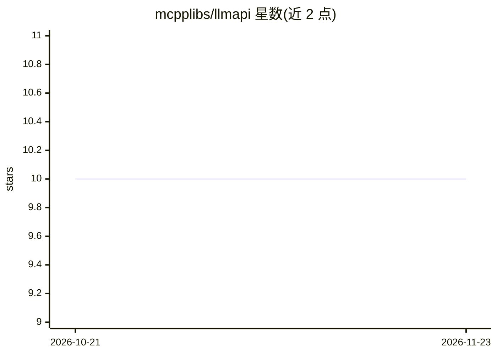

# mcpplibs/llmapi

⭐ 10 · C++ · Apache-2.0 · 推送 2026-06-10 · [GitHub](https://github.com/mcpplibs/llmapi) · [官网](https://mcpp.d2learn.org) · 组织维护 · 中文 README

**C++ 开发者的 OpenAI 兼容 LLM 客户端库**

基于 C++23 modules 的 LLM 客户端库，通过 mcpp 构建工具引入。提供类型化的 Client<Provider> API，覆盖聊天、流式输出、embeddings、工具调用与会话持久化。内置 OpenAI 与 Anthropic 两个 provider，兼容端点可通过 baseUrl 配置复用 OpenAI provider（如 DeepSeek）。附带多个项目模板（openai/chat/anthropic/deepseek），以 Apache-2.0 许可发布，文档另有 xmake 集成指引。

## 筛选速览

| 维度 | 判定 | 备注 |
|---|---|---|
| AI 角色 | `ai-ecosystem` | LLM/agent 周边工具 |
| 许可风险 | `permissive` | Apache-2.0 |
| 部署形态 | `None` |  |
| 模型依赖 | locked-api |  |
| 硬件要求 | — | 无带数字的原话,不猜 |
| 安装摩擦 | `low` | 无编译、无系统依赖或容器化 |
| 成熟度 | — | 结构信号不足 |

## 能力要点

- 类型化 Client<Provider> API：聊天、流式、embeddings、工具调用、会话存取
- C++23 modules，import 即用
- OpenAI 与 Anthropic provider，兼容端点经 baseUrl 复用
- mcpp 项目模板一键生成聊天 CLI 等应用

## 适用场景

- 在 C++ 项目中接入 OpenAI 兼容端点调用 LLM
- 用模板快速生成流式聊天 CLI
- 为 LLM 应用实现工具调用与对话持久化

## 场景标签

`模型网关` · 领域:Agent 开发

## 证据(README 行号)

> L15: `llmapi` provides a typed `Client<Provider>` API for chat, streaming, embeddings, tool calls, and conversation pers
> L59: - OpenAI-compatible endpoint support through `openai::Config::baseUrl`
> L73: - `openai::OpenAI` for OpenAI chat, streaming, embeddings, and OpenAI-compatible endpoints

## 星数曲线

2026-10-21 10 → 2026-11-23 10（+0）

---
*卡片 v1 · prompt 1.4 · 生成 2026-11-19 · 置信度 high · 依据 README sha `420d0ff4132c` · [字段定义](../../DATASET.md)*
