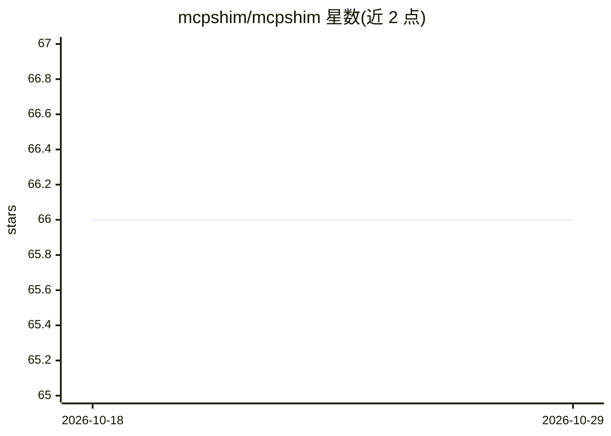

# mcpshim/mcpshim

⭐ 66 · Go · MIT · 推送 2026-08-13 · [GitHub](https://github.com/mcpshim/mcpshim) · [官网](https://mcpshim.dev) · 组织维护

**把远程 MCP 服务器与 HTTP API 封装成本地 CLI 命令的守护进程**

由 Go 编写的本地守护进程 mcpshimd 加 CLI 客户端 mcpshim 组成：集中管理远程 MCP 服务器注册、OAuth 认证与 HTTP 服务绑定，把每个远程 MCP 工具与配置的 HTTP 操作暴露为标准 shell 命令，flags 映射为工具参数，输出结构化 JSON。客户端与守护进程通过 Unix socket 以 JSON 协议通信，调用方无需 SDK。每次调用记录到 SQLite（默认保留最近 1,000 条），可生成 shell 别名包装。面向需要脚本化调用 MCP 工具的 agent 开发者与自动化脚本作者。

## 筛选速览

| 维度 | 判定 | 备注 |
|---|---|---|
| AI 角色 | `ai-ecosystem` | LLM/agent 周边工具 |
| 许可风险 | `permissive` | MIT |
| 部署形态 | `library` | 以包/库形式分发 |
| 模型依赖 | — | README 未给出锁定关系 |
| 硬件要求 | — | 无带数字的原话,不猜 |
| 安装摩擦 | `low` | 无编译、无系统依赖或容器化 |
| 成熟度 | — | 结构信号不足 |

## 能力要点

- 远程 MCP 工具与 HTTP API 统一暴露为本地 CLI 命令，输出结构化 JSON
- 集中式 OAuth 与认证头管理，凭据不可通过 socket 读回
- 基于 Unix socket 的 JSON IPC 协议，调用方无需 SDK 或库
- SQLite 调用历史（默认保留 1,000 条）与 shell 别名/可执行包装生成

## 适用场景

- 让 AI agent 或脚本直接以 shell 命令调用远程 MCP 工具，减少 prompt 中的 schema 占用
- 把已有 HTTP API 不写 MCP 服务器就接入 agent 工作流
- 集中管理多个 MCP 服务的认证并审计调用历史

## 场景标签

 · 领域:AI agent 基础设施/MCP 工具链

## 证据(README 行号)

> L5:  Use any MCP server or HTTP API as a standard CLI command.
> L22: `mcpshim` exposes every remote MCP tool and configured HTTP operation as a
> L41: |**Agent context budget**|Large MCP schemas in prompt|Alias-based local command workflows|

## 星数曲线

2026-10-18 66 → 2026-10-29 66（+0）

---
*卡片 v1 · prompt 1.4 · 生成 2026-10-24 · 置信度 high · 依据 README sha `7c64feece104` · [字段定义](../../DATASET.md)*
