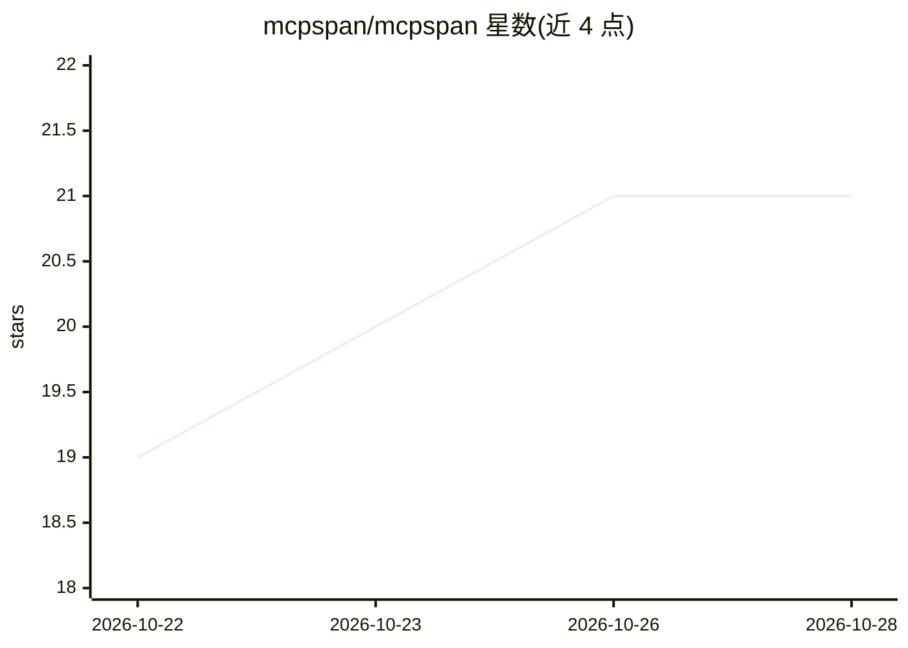

# mcpspan/mcpspan

⭐ 21 · TypeScript · MIT · 推送 2026-10-27 · [GitHub](https://github.com/mcpspan/mcpspan) · [官网](https://mcpspan.com) · 组织维护

**面向 MCP 服务器的自托管开源调用分析平台**

通过在 MCP 服务器代码中加一行 instrument 调用（8 种语言的官方/主流 SDK）或经代理运行，采集每次工具调用、资源读取与 prompt 获取：按客户端（Claude、Cursor、ChatGPT 等）统计响应时间分布、回答体积、失败分类（抛错/工具报错/参数被拒/请求了不存在的工具）、会话步骤与重复调用、版本对比。提供看板、Slack/Discord/webhook 告警、CSV/NDJSON 导出与 OpenTelemetry 转发；参数值不出本机进程。另附 API 本身也是一个 MCP 服务器供 agent 查询，以及 npx mcpspan-lint 工具定义检查器。面板以 docker compose 自托管运行。

## 筛选速览

| 维度 | 判定 | 备注 |
|---|---|---|
| AI 角色 | `ai-ecosystem` | LLM/agent 周边工具 |
| 许可风险 | `permissive` | MIT |
| 部署形态 | `self-host` | docker 或自建部署 |
| 模型依赖 | — | README 未给出锁定关系 |
| 硬件要求 | — | 无带数字的原话,不猜 |
| 安装摩擦 | `low` | 无编译、无系统依赖或容器化 |
| 成熟度 | — | 结构信号不足 |

## 能力要点

- 8 种语言 SDK 仪表化 + 免改码代理两种接入方式
- 失败细分：抛错、工具错误、参数被拒、请求不存在的工具（含最接近名称）
- 按客户端/版本维度统计延迟分布、回答体积、会话重复调用
- 告警（Slack/Discord/webhook）与 CSV/NDJSON 导出、OpenTelemetry 转发

## 适用场景

- 自托管监控 MCP 服务器的工具调用成功率与延迟
- 排查 agent 会话中的循环调用与失败原因
- 对比 MCP 服务器不同版本的调用表现并接入 Grafana 等现有可观测体系

## 场景标签

`LLM 可观测性` · 领域:评测与运维

## 证据(README 行号)

> L3:  Open-source, self-hosted analytics for MCP servers.
> L7: Add one line to your MCP server, run the dashboard with `docker compose up`,
> L17: - **Every call, from every client.** Tool calls, resource reads and prompt

## 星数曲线

2026-10-22 19 → 2026-10-28 21（+2）

---
*卡片 v1 · prompt 1.4 · 生成 2026-10-28 · 置信度 high · 依据 README sha `91d7fe09da1c` · [字段定义](../../DATASET.md)*
