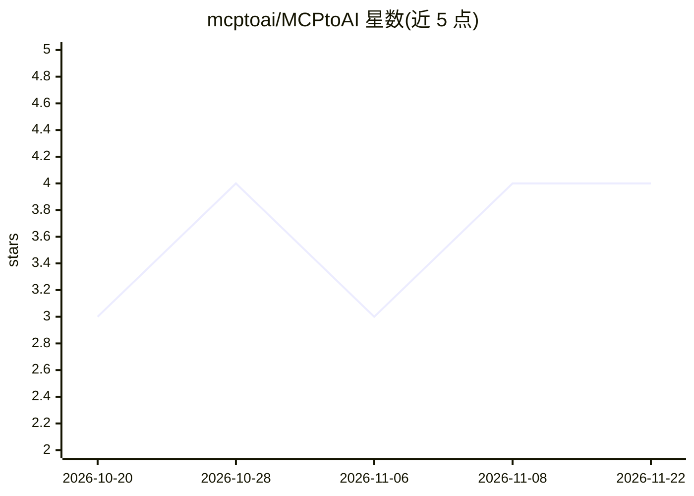

# mcptoai/MCPtoAI

⭐ — · [GitHub]() · 组织维护

**让所选 AI 模型经设备端权限控制操作配对电脑与 MCP 工具**

由 Desktop 客户端（Electron）、Device Agent、Linux CLI（PyPI 包 mcptoai）与 Docker 镜像组成，配合官方托管的 Web 端与中继服务：用户在 Web 端发起对话，模型可调用配对电脑上的文件访问、终端命令及已连接的 MCP 服务器工具；本地能力按设备端 Off/Ask/Allow 权限管理，高危操作需实时批准。支持同一会话中切换模型并保留上下文（约 24,000 token 预算），提供者凭证存于本机，会话历史可选云端或仅设备存储。托管基础设施闭源，不在此仓库内；当前不提供端到端加密，传输使用 TLS。

## 筛选速览

| 维度 | 判定 | 备注 |
|---|---|---|
| AI 角色 | `ai-ecosystem` | LLM/agent 周边工具 |
| 许可风险 | `permissive` | — |
| 部署形态 | `self-host` | docker 或自建部署 |
| 模型依赖 | — | README 未给出锁定关系 |
| 硬件要求 | — | 无带数字的原话,不猜 |
| 安装摩擦 | `low` | 无编译、无系统依赖或容器化 |
| 成熟度 | `idea` | |

## 能力要点

- 设备端 Off/Ask/Allow 三级权限与高危操作实时批准
- 同一会话内切换 AI 提供者/模型并保留约 24,000 token 上下文预算
- 支持内置、远程 Streamable HTTP 与本地 stdio MCP 服务器连接，按工具粒度控制权限
- Skills 安装需 40 位 commit SHA 审查与显式批准，凭证存于系统级凭据库

## 适用场景

- 在外出时通过手机或浏览器让 AI 操作家中/办公室配对电脑
- 将 GitHub、Google Drive 等 MCP 集成接入同一对话工作流
- 对本地文件与终端操作要求权限可控的 AI 工具调用

## 场景标签

`AI 助手` `聊天机器人` · 领域:对话与助手

## 证据(README 行号)

> L28: Most AI chats stop at the conversation. MCPtoAI lets the model you choose work with a paired computer and connected
> L141: |**MCP support**|Connect MCP servers and expose their tools through the same workspace.|
> L174: The MCPtoAI clients are open source. The hosted web app, relay and production infrastructure are operated by BKTY 

## 星数曲线

2026-10-20 3 → 2026-11-22 4（+1）

---
*卡片 v1 · prompt 1.4 · 生成 2026-11-21 · 置信度 high · 依据 README sha `44331dbec82d` · [字段定义](../../DATASET.md)*
