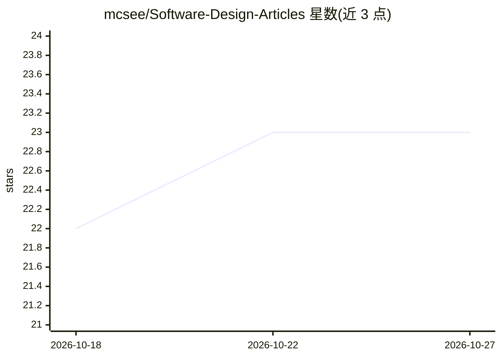

# mcsee/Software-Design-Articles

⭐ 23 · JavaScript · MIT · 推送 2026-10-15 · [GitHub](https://github.com/mcsee/Software-Design-Articles) · [官网](https://maximilianocontieri.com/) · 个人维护

**软件设计文章目录：代码坏味道、重构、TDD 等主题文章链接合集**

由 Maxi Contieri 撰写的软件设计相关文章索引仓库，README 即目录：按 Theory、Opinion、Quotes、TDD、Code Smells 等分类列出文章链接，其中 Code Smells 系列编号至 274，覆盖 Anemic Models、God Objects、Singleton 等具体坏味道，另含耦合、Fail Fast、命名等理论主题与面向初中级开发者的建议类文章。仓库为纯清单，不提供代码安装或运行方式。

## 筛选速览

| 维度 | 判定 | 备注 |
|---|---|---|
| AI 角色 | `ai-knowledge` | 知识聚合/清单类 |
| 许可风险 | `permissive` | MIT |
| 部署形态 | `None` |  |
| 模型依赖 | — | README 未给出锁定关系 |
| 硬件要求 | — | 无带数字的原话,不猜 |
| 安装摩擦 | `low` | 无编译、无系统依赖或容器化 |
| 成熟度 | — | 结构信号不足 |

## 能力要点

- Code Smells 系列编号至 274 条
- 覆盖理论、TDD、观点、名言等多个分类
- 每条目为带代码示例的文章链接

## 适用场景

- 查找特定代码坏味道对应的讲解文章
- 系统学习重构、SOLID、TDD 等软件设计主题
- 按目录浏览作者的文章合集

## 场景标签

`精选清单` · 领域:学习与行业

## 证据(README 行号)

> L1: # Software Design Articles
> L3: In this repository, you will find many articles related to Software Design
> L77: ### Code Smells
> L79: * How to Find the Stinky Parts of Your Code

## 星数曲线

2026-10-18 22 → 2026-10-27 23（+1）

---
*卡片 v1 · prompt 1.4 · 生成 2026-10-27 · 置信度 high · 依据 README sha `c1558973ecd2` · [字段定义](../../DATASET.md)*
