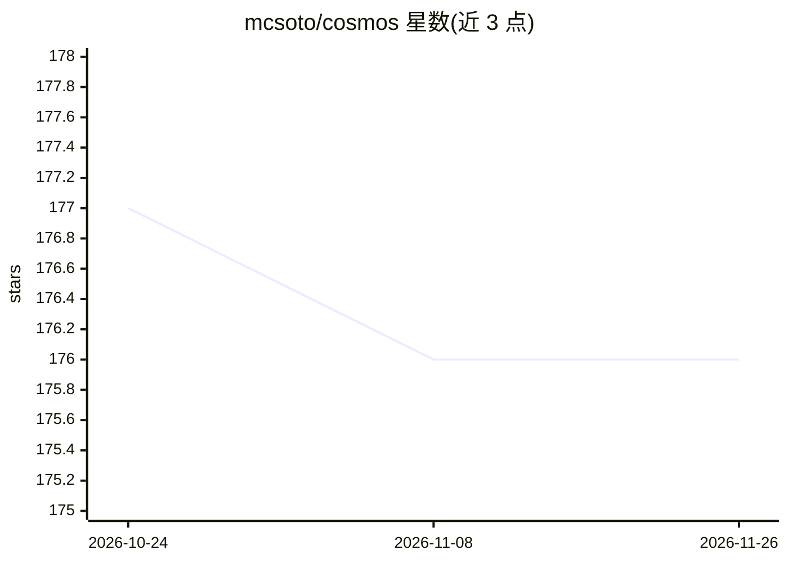

# mcsoto/cosmos

⭐ 176 · Prolog · 推送 2026-11-24 · [GitHub](https://github.com/mcsoto/cosmos) · [官网](https://cosmos-lang.github.io/) · 个人维护

**面向通用编程的多范式逻辑编程语言及其自举编译器**

Cosmos 是一种逻辑编程语言，v1 提供函数-逻辑核心，支持表格和 JSON 类结构；v2 计划支持可变状态式命令风格与时间性 IR 等多种编程风格，并提供静态类型/模式检查。编译器以自举方式实现（compiler/src），运行在 SWI-Prolog 之上，依赖 xpce 图形库；提供 REPL、采样性能分析器（--profile）、WASM 测试目标，附带示例程序（如基于 Space 图形库的地牢爬行游戏）。安装需先装 Swi-Prolog 10.0.2+，再通过 make 构建。

## 筛选速览

| 维度 | 判定 | 备注 |
|---|---|---|
| AI 角色 | `ai-enhanced` | 去掉 AI 部分产品仍成立 |
| 许可风险 | `none` | — |
| 部署形态 | `desktop` | 安装包/桌面程序 |
| 模型依赖 | — | README 未给出锁定关系 |
| 硬件要求 | — | 无带数字的原话,不猜 |
| 安装摩擦 | `low` | 无编译、无系统依赖或容器化 |
| 成熟度 | — | 结构信号不足 |

## 能力要点

- 多范式逻辑编程语言：函数-逻辑核心，v2 扩展命令风格与静态类型/模式检查
- 自举编译器运行于 SWI-Prolog，无 Lua 依赖，含 WASM 测试目标
- 内置采样性能分析器，按谓词调用次数与后端归属生成报告
- 附带 xpce 图形库（Space）示例程序与 REPL

## 适用场景

- 学习或实验逻辑编程与多范式语言设计
- 用 Space 图形库编写小型游戏程序并用内置分析器做性能分析
- 在 SWI-Prolog 生态上编译和运行 .co 程序

## 场景标签

 · 领域:编程语言/编译器

## 证据(README 行号)

> L14: A relational programming language.
> L76: v1 is a functional-logic core. It includes supports for tables; json-like structures.

## 星数曲线

2026-10-24 177 → 2026-11-26 176（-1）

---
*卡片 v1 · prompt 1.4 · 生成 2026-11-26 · 置信度 mid · 依据 README sha `4f29bf7ffdb3` · [字段定义](../../DATASET.md)*
