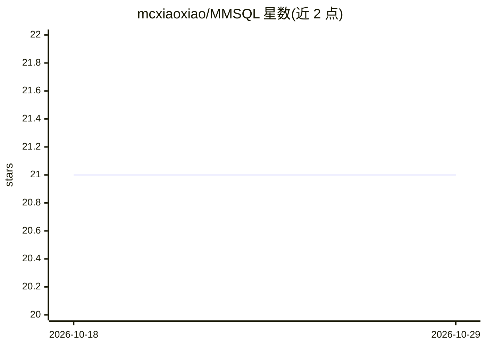

# mcxiaoxiao/MMSQL

⭐ 21 · Jupyter Notebook · 推送 2026-10-07 · [GitHub](https://github.com/mcxiaoxiao/MMSQL) · [官网](https://mcxiaoxiao.github.io/MMSQL/) · 组织维护

**多轮多类型 text-to-SQL 评测数据集与实验代码（IJCNN2025）**

IJCNN2025 论文 'Evaluating and Enhancing LLMs for Multi-turn Text-to-SQL with Multiple Question Types' 的配套仓库：提供 MMSQL 测试/训练集（基于 CoSQL 的 sqlite 数据库构建，部分数据由 QDA-SQL 生成）、4 agent 多智能体框架（selector/detector/decomposer/refiner）、LLM 回答生成脚本、GPT-4o-mini 打分的 RQS 评估脚本与 TDEX/EX/EM 等指标计算脚本及分析 notebook。面向 text-to-SQL 与 LLM 评测研究者，复现实验需下载 CoSQL 数据并配置 LLM API。

## 筛选速览

| 维度 | 判定 | 备注 |
|---|---|---|
| AI 角色 | `ai-knowledge` | 知识聚合/清单类 |
| 许可风险 | `none` | — |
| 部署形态 | `None` |  |
| 模型依赖 | — | README 未给出锁定关系 |
| 硬件要求 | — | 无带数字的原话,不猜 |
| 安装摩擦 | `low` | 无编译、无系统依赖或容器化 |
| 成熟度 | — | 结构信号不足 |

## 能力要点

- MMSQL 多轮多问题类型测试集与训练集（基于 CoSQL 构建）
- 4 agent 多智能体框架及对应 prompt 设计
- RQS 用 GPT-4o-mini 打分，TDEX_eval 计算 TDEX/EX/EM 等指标
- 支持 huggingface 或 API 两种 LLM 接入生成回答

## 适用场景

- 评测自家 LLM 在多轮 text-to-SQL 上的表现
- 复现论文实验结果
- 基于数据集训练 text-to-SQL 模型

## 场景标签

`模型评测` `数据分析` · 领域:效率与自动化

## 证据(README 行号)

> L5:  This repository contains the scripts and code used for the experiments in paper "Evaluating and Enhancing LLMs for 
> L9: - `datasets/`: MMSQL test set `MMSQL_test.json`, MMSQL train set `MMSQL_train.json`, CoSQL dataset `cosql_dataset` (

## 星数曲线

2026-10-18 21 → 2026-10-29 21（+0）

---
*卡片 v1 · prompt 1.4 · 生成 2026-10-28 · 置信度 high · 依据 README sha `b952c04ae940` · [字段定义](../../DATASET.md)*
