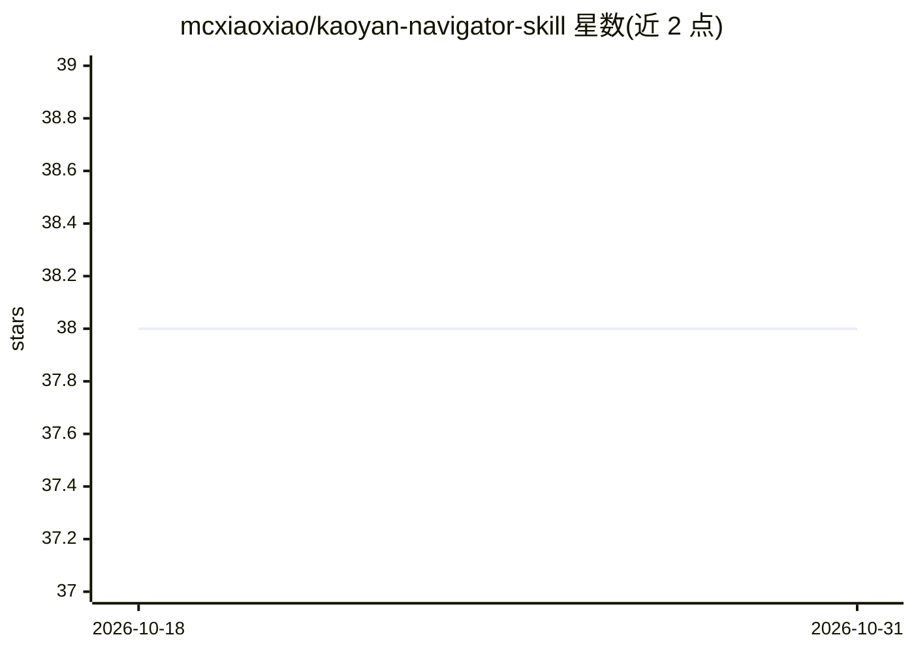

# mcxiaoxiao/kaoyan-navigator-skill

⭐ 38 · Python · MIT · 推送 2026-10-07 · [GitHub](https://github.com/mcxiaoxiao/kaoyan-navigator-skill) · 个人维护 · 中文 README

**给 Codex/Claude Code 的考研择校导航 Skill：联网调研数据并出冲稳保建议**

面向 Codex、Claude Code 与通用 AI Agent 的中国考研择校导航 Skill。输入学校、学院、专业与入学年份后，Agent 先从研究生院、研招网、拟录取公示等公开渠道检索历年复试线、统考名额、推免与拟录取数据，找不到关键字段时才向用户索取 CSV/PDF/截图等材料。附带数据校验与检索计划生成脚本，输出保留来源、口径、缺失项、证据质量与置信度，并给出冲稳保建议与风险信号，不做预测。安装方式为将仓库复制到本机技能目录。

## 筛选速览

| 维度 | 判定 | 备注 |
|---|---|---|
| AI 角色 | `ai-ecosystem` | LLM/agent 周边工具 |
| 许可风险 | `permissive` | MIT |
| 部署形态 | `None` |  |
| 模型依赖 | — | README 未给出锁定关系 |
| 硬件要求 | — | 无带数字的原话,不猜 |
| 安装摩擦 | `low` | 无编译、无系统依赖或容器化 |
| 成熟度 | — | 结构信号不足 |

## 能力要点

- 公开来源优先的数据获取流程：官网/研究生院/研招网检索，缺失才索要 CSV/PDF/截图
- 提供 validate_data.py 数据校验与 research_plan.py 检索计划生成脚本
- 输出保留来源等级、URL、缺失项、证据质量与置信度
- 对爆热/缩招/推免挤压/复试线虚低/改考做分项审计并给冲稳保建议

## 适用场景

- 让 AI Agent 调研目标院校专业的历年复试线与统考名额
- 整理已有历年招生数据并校验后生成择校建议
- 评估推免挤压、缩招等择校风险

## 场景标签

`数据分析` `网页抓取` · 领域:效率与自动化

## 证据(README 行号)

> L5: 一个面向 **Codex、Claude Code 和通用 AI Agent** 的中国考研择校导航 Skill。输入目标学校、学院和专业后，Agent 会先从学校官网、研究生院、研招网和公开名单中寻找历年数据；只有关键数据确实找不到
> L28: > 输入学校 / 学院 / 专业代码 / 入学年份 → 公开检索 → 证据分级 → 数据校验 → 冲稳保建议

## 星数曲线

2026-10-18 38 → 2026-10-31 38（+0）

---
*卡片 v1 · prompt 1.4 · 生成 2026-10-25 · 置信度 high · 依据 README sha `c088301e6bc2` · [字段定义](../../DATASET.md)*
