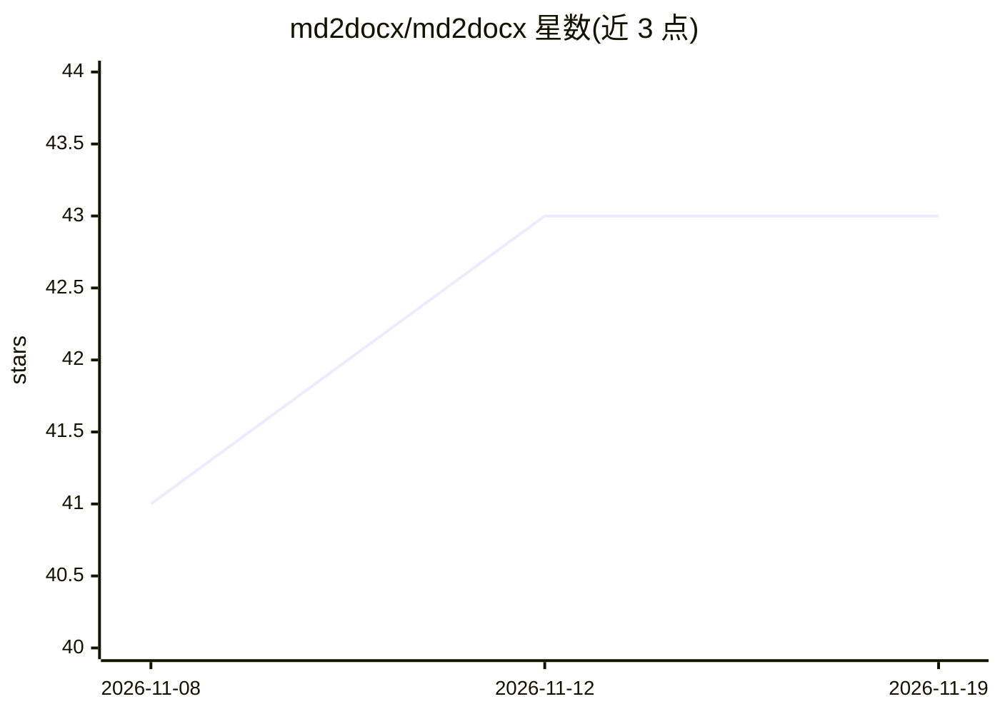

# md2docx/md2docx

⭐ 43 · MDX · MIT · 推送 2026-11-10 · [GitHub](https://github.com/md2docx/md2docx) · [官网](https://md2docx.js.org/) · 组织维护

**将 Markdown/AST 转换为 DOCX 的 Node.js 插件化文档编译生态**

基于 Unified/MDAST 架构的 Monorepo 文档转换引擎：将 Markdown 抽象语法树转换为 Word OpenXML 原生元素（表格、MathML 公式、图片、多级编号），供需要把 Generative AI 产出的 Markdown 结构化输出渲染为 Word 文档的开发者使用。提供约 18 个包：all-in-one 包、核心引擎、CLI、表格/列表/公式/Mermaid/图片/HTML 等插件，区分浏览器端（Blob 零服务器）与 Node.js 端（Buffer/sharp/linkedom）实现，含语法自修复与缓存层。MIT 许可。

## 筛选速览

| 维度 | 判定 | 备注 |
|---|---|---|
| AI 角色 | `ai-enhanced` | 去掉 AI 部分产品仍成立 |
| 许可风险 | `permissive` | MIT |
| 部署形态 | `library` | 以包/库形式分发 |
| 模型依赖 | — | README 未给出锁定关系 |
| 硬件要求 | — | 无带数字的原话,不猜 |
| 安装摩擦 | `low` | 无编译、无系统依赖或容器化 |
| 成熟度 | — | 结构信号不足 |

## 能力要点

- Markdown/MDAST 转换为原生 Word OpenXML 元素（docx.Table/docx.Math 等）
- 插件化架构：all-in-one 包、CLI 或按需选配 @m2d/* 官方插件
- 浏览器端零服务器生成与 Node.js 高吞吐批量生成双运行时
- LaTeX 公式转原生可编辑 Word MathML，Mermaid 图带语法自动修复

## 适用场景

- 把 AI 工具输出的 Markdown 渲染为格式规范的 Word 文档
- 在浏览器端或服务端批量生成 DOCX 报告
- 为技术文档平台集成 Markdown 到 Word 的导出功能

## 场景标签

 · 领域:文档处理/开发工具

## 证据(README 行号)

> L29: Modern applications, technical platforms, and **Generative AI** tools produce structured output in **Markdown**. `M
> L31: - 📐 **Authentic Word Elements**: Converts Markdown directly into native Microsoft Word OpenXML elements (`docx.Tabl

## 星数曲线

2026-11-08 41 → 2026-11-19 43（+2）

---
*卡片 v1 · prompt 1.4 · 生成 2026-11-18 · 置信度 mid · 依据 README sha `8b17ba3ef0a3` · [字段定义](../../DATASET.md)*
