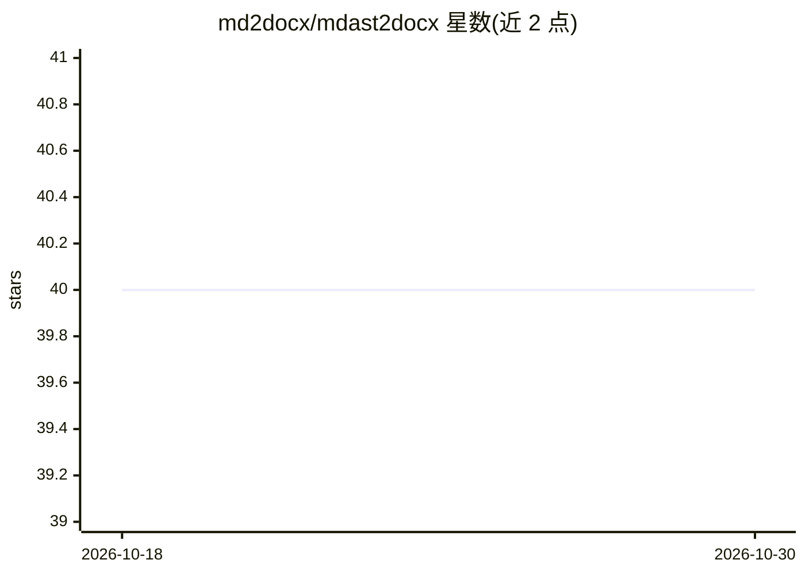

# md2docx/mdast2docx

⭐ 40 · TypeScript · MPL-2.0 · 推送 2026-10-21 · [GitHub](https://github.com/md2docx/mdast2docx) · [官网](https://github.com/md2docx/md2docx/tree/main/packages/mdast2docx) · 个人维护

**将 MDAST（Markdown 抽象语法树）转换为 DOCX 文档的 JS 库**

基于 unified.js 与 docx.js 构建的 Markdown 转 DOCX 转换库，提供 toDocx API 将一个或多个 MDAST 树输出为 DOCX（blob/buffer/base64）。核心保持精简，图片、表格、LaTeX 公式、HTML 等能力经 @m2d/* 插件添加，既可整体安装 mdast2docx，也可按需安装 scoped 包。同构设计，可在 Node.js 与浏览器运行。README 将转换 AI 生成的 Markdown 报告与文章列为主要使用场景。注意：本仓库已归档，开发迁移至 md2docx monorepo。

## 筛选速览

| 维度 | 判定 | 备注 |
|---|---|---|
| AI 角色 | `ai-enhanced` | 去掉 AI 部分产品仍成立 |
| 许可风险 | `permissive` | MPL-2.0 |
| 部署形态 | `library` | 以包/库形式分发 |
| 模型依赖 | — | README 未给出锁定关系 |
| 硬件要求 | — | 无带数字的原话,不猜 |
| 安装摩擦 | `low` | 无编译、无系统依赖或容器化 |
| 成熟度 | — | 结构信号不足 |

## 能力要点

- toDocx API 将 MDAST 转为 DOCX，支持多树与分节属性
- 插件化架构：图片/表格/公式/HTML 经 @m2d/* 插件按需加载
- 同构设计，浏览器与 Node.js 均可运行，输出 blob/buffer/base64

## 适用场景

- 把 AI 生成的 Markdown 报告或文章导出为可编辑的 DOCX
- 在 Web 应用中为用户生成 Word 文档下载
- 服务端批量将 Markdown 内容转换为 DOCX

## 场景标签

 · 领域:文档处理/开发者工具

## 证据(README 行号)

> L19: MD2DOCX is a robust library for converting Markdown Abstract Syntax Trees (MDAST) into DOCX documents. Built on the
> L38: Modern **Generative AI** tools often produce structured content in **Markdown**. This library acts as the perfect b

## 星数曲线

2026-10-18 40 → 2026-10-30 40（+0）

---
*卡片 v1 · prompt 1.4 · 生成 2026-10-25 · 置信度 high · 依据 README sha `a1212fd8cad6` · [字段定义](../../DATASET.md)*
