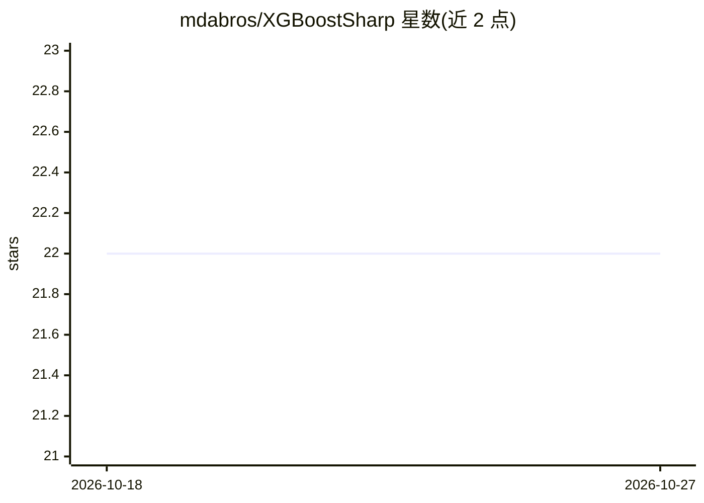

# mdabros/XGBoostSharp

⭐ 22 · C# · MIT · 推送 2026-07-13 · [GitHub](https://github.com/mdabros/XGBoostSharp) · 个人维护

**.NET 版 XGBoost 封装库，让 C# 训练与预测梯度提升模型**

基于 XGBoost Python API 的 .NET 封装库，目标是让 C# 开发者以与 Python API 相近的方式使用 XGBoost。当前支持 XGBClassifier 与 XGBRegressor 两类估计器，可传入数据与标签训练并预测，另提供 DMatrix 数据结构（可从二维 float 数组创建）。托管包通过 nuget.org 分发，原生库以独立 NuGet 包形式提供，覆盖 win-x64/linux-x64/osx-x64/osx-arm64 的 CPU 版本，以及 Windows 下 CUDA 12.8 的原生包。

## 筛选速览

| 维度 | 判定 | 备注 |
|---|---|---|
| AI 角色 | `ai-native` | 本体是模型或模型工具 |
| 许可风险 | `permissive` | MIT |
| 部署形态 | `None` |  |
| 模型依赖 | — | README 未给出锁定关系 |
| 硬件要求 | — | 无带数字的原话,不猜 |
| 安装摩擦 | `medium` | 含编译或系统依赖之一 |
| 成熟度 | — | 结构信号不足 |

## 能力要点

- 提供 XGBClassifier 与 XGBRegressor，API 风格对齐 Python 版 XGBoost
- DMatrix 支持，可从二维 float 数组创建
- NuGet 分发，原生包覆盖 win-x64/linux-x64/osx-x64/osx-arm64
- 提供 Windows 平台 CUDA 12.8 原生包

## 适用场景

- C#/.NET 项目中直接训练和使用 XGBoost 分类/回归模型
- 从 Python XGBoost 迁移到 .NET 时保持相近的 API 体验
- Windows 上用 CUDA 加速 XGBoost 训练

## 场景标签

 · 领域:机器学习/开发库

## 证据(README 行号)

> L7: .Net wrapper for XGBoost based on the Python API.
> L10: Currently supports `XGBoostClassifier` and `XGBoostRegressor`.

## 星数曲线

2026-10-18 22 → 2026-10-27 22（+0）

---
*卡片 v1 · prompt 1.4 · 生成 2026-10-27 · 置信度 high · 依据 README sha `9e0fb209e840` · [字段定义](../../DATASET.md)*
