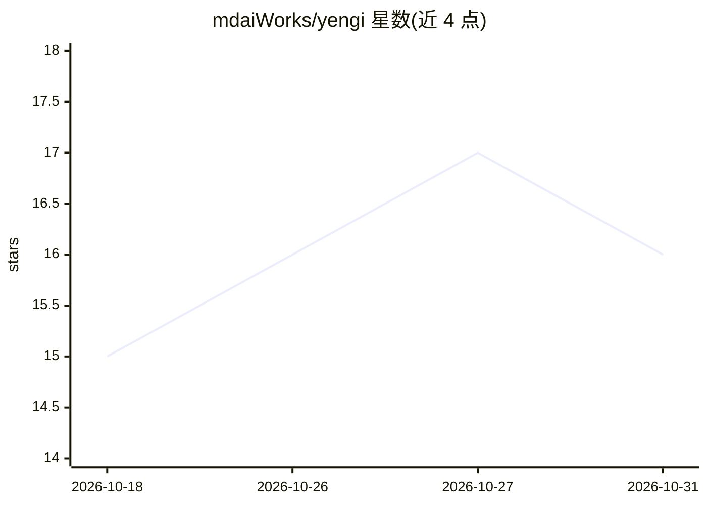

# mdaiWorks/yengi

⭐ 16 · C# · AGPL-3.0 · 推送 2026-10-17 · [GitHub](https://github.com/mdaiWorks/yengi) · [官网](https://youtu.be/l0tdhvCmwNI) · 个人维护

**Windows 开源 AI IDE：本地/云模型驱动的自主开发代理**

基于 .NET 10 WPF 的 Windows 桌面 AI IDE，提供 Code IDE、图像生成、Blender 3D Copilot 与 Unity Copilot 四种模式。运行 Plan→Tool Call→Verification→Auto-Fix 自主代理循环，内置微调的 1.5B 本地路由模型（GGUF 约 940MB）选择工具工作流，支持 Ollama 本地模型与 Claude/OpenAI/Gemini 云 API。集成 Blender 实时视口视觉校正、自主浏览器代理、应用商店发布流水线与 39 个原生工具。安装途径为 GitHub Releases 安装包或 .NET 10 SDK 源码构建，仅限 Windows。

## 筛选速览

| 维度 | 判定 | 备注 |
|---|---|---|
| AI 角色 | `ai-ecosystem` | LLM/agent 周边工具 |
| 许可风险 | `viral` | AGPL-3.0 |
| 部署形态 | `desktop` | 安装包/桌面程序 |
| 模型依赖 | local-ok | 支持本地模型 |
| 硬件要求 | — | 无带数字的原话,不猜 |
| 安装摩擦 | `medium` | 含编译或系统依赖之一 |
| 成熟度 | — | 结构信号不足 |

## 能力要点

- 自主代理循环：计划→工具调用→代码变更→构建验证→自动修复
- 微调 1.5B 本地路由模型，约 0.2s 延迟、940MB GGUF
- Blender/Unity 双向集成，含 Two-Stage Architect 管线与 Scene RAG
- 39 个原生代理工具，含自主浏览器控制与应用商店部署

## 适用场景

- 在 Windows 上用本地或云端模型进行代理式编码与自动验证修复
- 在 Blender/Unity 中生成 3D 资产与组件脚本并实时视口校正
- 自动化应用商店素材制作与 APK/AAB 发布

## 场景标签

`编码 Agent` `图像生成` · 领域:编码与开发

## 证据(README 行号)

> L17: **Yengi is a free, open-source Windows desktop AI IDE powered by .NET 10 (LTS). It combines local LLMs (Ollama, Qwe
> L33: Yengi goes beyond a standard AI chat box. It runs an end-to-end **Plan → Tool Call → Code Mutation → Verification →
> L84: - 🧠 **Custom 1.5B Local AI Router**: Fine-tuned 1.5B routing model designed to select the appropriate AI workflow a

## 星数曲线

2026-10-18 15 → 2026-10-31 16（+1）

---
*卡片 v1 · prompt 1.4 · 生成 2026-10-29 · 置信度 high · 依据 README sha `ac6173834243` · [字段定义](../../DATASET.md)*
