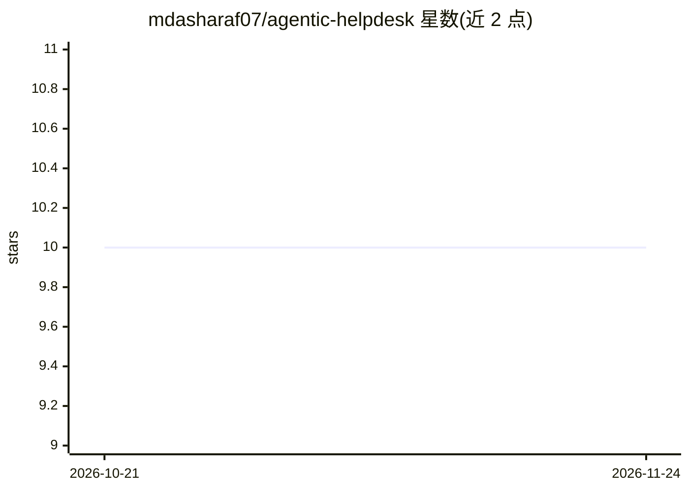

# mdasharaf07/agentic-helpdesk

⭐ 10 · Python · 推送 2026-01-08 · [GitHub](https://github.com/mdasharaf07/agentic-helpdesk) · 个人维护

**多 Agent 自主处理工单分诊、解决与升级的客服平台**

以结构化多 Agent 架构自动处理客服工单的全栈平台：Classifier、Planner、Resolution、Verification、Escalation、Learning 六类 Agent 分别承担分类、决策、执行、校验、升级与历史学习，并提供指标（解决率、升级率、单票成本等）与日志的可观测层。后端 FastAPI/Node.js，前端 React/Next.js 工单仪表盘，数据层 PostgreSQL 加向量数据库。README 未见具体安装步骤与依赖清单，项目处于活跃开发状态。

## 筛选速览

| 维度 | 判定 | 备注 |
|---|---|---|
| AI 角色 | `ai-native` | 本体是模型或模型工具 |
| 许可风险 | `none` | — |
| 部署形态 | `None` |  |
| 模型依赖 | — | README 未给出锁定关系 |
| 硬件要求 | — | 无带数字的原话,不猜 |
| 安装摩擦 | `low` | 无编译、无系统依赖或容器化 |
| 成熟度 | — | 结构信号不足 |

## 能力要点

- 六类专职 Agent 的显式角色与决策边界划分
- 置信度阈值与策略约束驱动的人工升级机制
- 知识库检索、API、脚本等工具增强的问题求解
- 按工单与聚合维度的成本/延迟/准确率指标追踪

## 适用场景

- 自动分诊并尝试解决客户支持工单
- 低置信度工单自动转人工并追踪升级
- 分析工单解决率与单票成本以优化客服流程

## 场景标签

`多智能体` `LLM 可观测性` · 领域:Agent 开发

## 证据(README 行号)

> L5: This project is an agentic AI-powered helpdesk platform designed to autonomously resolve customer support tickets us
> L12: - Multi-agent orchestration with explicit roles
> L98: 1. User submits a support ticket

## 星数曲线

2026-10-21 10 → 2026-11-24 10（+0）

---
*卡片 v1 · prompt 1.4 · 生成 2026-11-19 · 置信度 mid · 依据 README sha `0ca6cf8b23df` · [字段定义](../../DATASET.md)*
