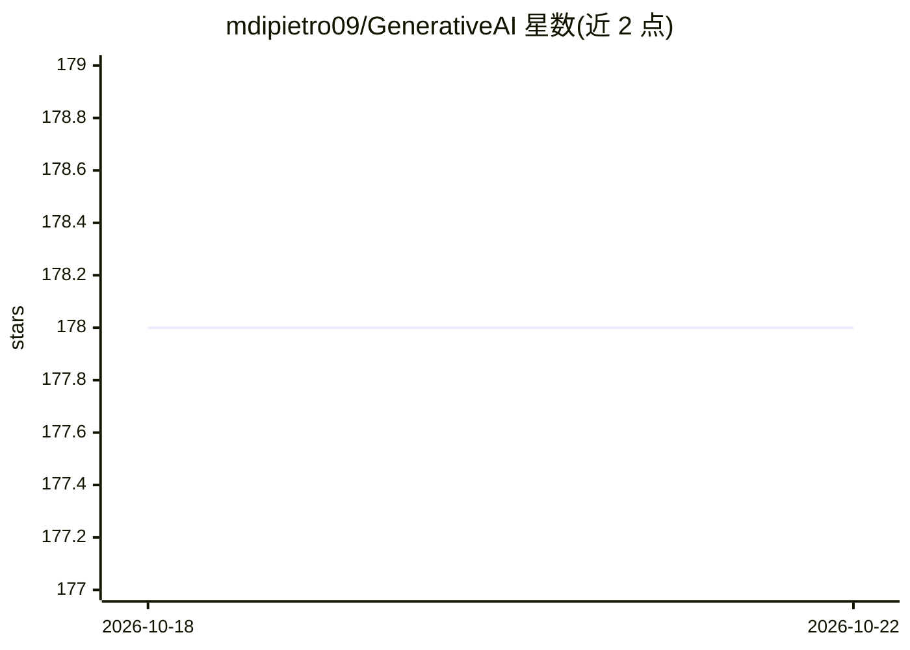

# mdipietro09/GenerativeAI

⭐ 178 · Jupyter Notebook · 推送 2025-10-28 · [GitHub](https://github.com/mdipietro09/GenerativeAI) · 个人维护

**生成式 AI 与 LLM 应用示例集：聊天机器人、Agent、RAG**

个人维护的 GenAI/LLM 应用示例仓库，用 Python 实现并配套 Medium 文章讲解。包含三个项目：基于 Ollama 与语音识别的本地语音聊天助手、无需 GPU 的多 Agent 协作自动化，以及支持多模态数据的本地 RAG 问答（自称构建你自己的 ChatGPT）。所有示例设计为在个人笔记本上运行，无需 GPU。面向学习 GenAI 应用开发的 Python 开发者。

## 筛选速览

| 维度 | 判定 | 备注 |
|---|---|---|
| AI 角色 | `ai-knowledge` | 知识聚合/清单类 |
| 许可风险 | `none` | — |
| 部署形态 | `None` |  |
| 模型依赖 | — | README 未给出锁定关系 |
| 硬件要求 | — | 无带数字的原话,不猜 |
| 安装摩擦 | `low` | 无编译、无系统依赖或容器化 |
| 成熟度 | — | 结构信号不足 |

## 能力要点

- 基于 Ollama + 语音识别的本地语音 LLM 聊天助手
- 无需 GPU 的多 Agent 协作示例
- 多模态数据本地 RAG 问答示例
- 每个项目均有 Medium 文档讲解

## 适用场景

- 学习如何在本地笔记本搭建 LLM 语音助手
- 参考多 Agent 自动化与 RAG 应用的实现
- 跟随 Medium 教程入门 GenAI 应用开发

## 场景标签

`多智能体` `语音 Agent` `RAG` `教程课程` · 领域:Agent 开发

## 证据(README 行号)

> L3: In this repo you can find useful examples of GenAI & LLM applications.\
> L4: All the projects are documented on *Medium*.

## 星数曲线

2026-10-18 178 → 2026-10-22 178（+0）

---
*卡片 v1 · prompt 1.4 · 生成 2026-10-22 · 置信度 high · 依据 README sha `0885e588afb3` · [字段定义](../../DATASET.md)*
