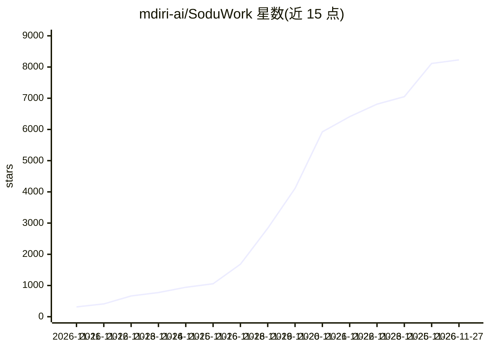

# mdiri-ai/SoduWork

⭐ 8,229 · JavaScript · MIT · 推送 2026-11-26 · [GitHub](https://github.com/mdiri-ai/SoduWork) · [官网](https://www.soduwork.ai) · 组织维护 · 中文 README

**团队与 agent 的自托管工作引擎：请求、执行、验收闭环**

自托管的多 harness、多 agent 协作平台：将任务以带验收标准的请求形式进入共享 issue 池，AI 补充验收标准后分配给人或 agent，由另一个 harness 的独立 AI 审查，最终由人签收；执行通过的对话可保存为插件，经审核后在团队目录共享与授权。通过统一适配器接入 7 种 harness（Pi 内置、OpenCode、DeepSeek/Qwen/Kimi/Codex 等，多数经 ACP），支持中途切换、云 runner、角色/成本/审计治理。提供源码启动、桌面安装包与 Docker 部署三种方式。

## 筛选速览

| 维度 | 判定 | 备注 |
|---|---|---|
| AI 角色 | `ai-ecosystem` | LLM/agent 周边工具 |
| 许可风险 | `permissive` | MIT |
| 部署形态 | `desktop` | 安装包/桌面程序 |
| 模型依赖 | — | README 未给出锁定关系 |
| 硬件要求 | — | 无带数字的原话,不猜 |
| 安装摩擦 | `low` | 无编译、无系统依赖或容器化 |
| 成熟度 | `idea` | |

## 能力要点

- 请求携带验收标准，独立 AI 审查加人工签收的交付闭环
- 7 种 harness 经统一适配器接入，支持中途切换并保留历史
- 对话可保存为插件，经审核、授权、版本化后在团队共享
- 自托管部署，提供角色、用量、成本与审计日志

## 适用场景

- 团队把 AI 产出纳入工单流程，由人验收后再交付
- 把个人调通的 AI 工作方法沉淀为团队可复用插件
- 在多个 agent harness 与模型间按任务分配并控制成本
- 个人用 issue 池批量处理任务，只做最终签收

## 场景标签

`多智能体` `编码 Agent` · 领域:Agent 开发

## 证据(README 行号)

> L9: ## The AI-native engine for teams and their agents
> L167: A harness is the agent runtime that does the work. It is not the model. SoduWork connects every harness through on
> L89: The first run installs dependencies, then starts the Hub, the admin console and the desktop client on this computer

## 星数曲线

2026-11-11 314 → 2026-11-27 8,229（+7,915）

---
*卡片 v1 · prompt 1.4 · 生成 2026-11-26 · 置信度 high · 依据 README sha `5686d6d9f6d3` · [字段定义](../../DATASET.md)*
