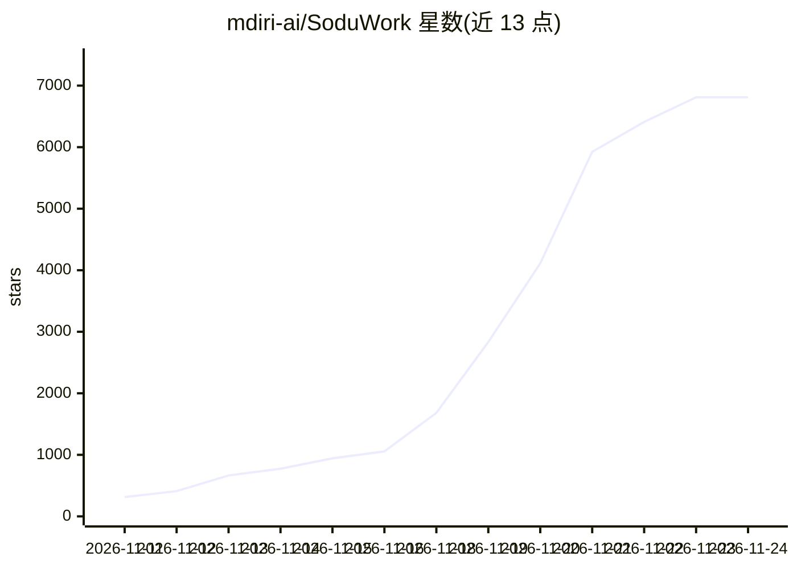

# mdiri-ai/SoduWork

⭐ 6,810 · JavaScript · MIT · 推送 2026-11-22 · [GitHub](https://github.com/mdiri-ai/SoduWork) · [官网](https://www.soduwork.ai) · 组织维护 · 中文 README

**团队自托管的多 harness 多 agent 协作引擎**

自托管的多 harness、多 agent 协作平台：把 Pi、OpenCode、DeepSeek/Qwen/Kimi Code、Codex 等 agent 运行时经统一适配接口接入共享 issue 池，覆盖请求、执行、审查、签收全流程。关键机制包括：AI 补全验收标准、由另一 harness 独立审查、请求者签收才算完成；聊天可保存为插件经审核后团队复用，支持授权与撤销；提供角色、用量、成本与审计日志。当前为公开 beta，README 建议生产使用前先行评估。

## 筛选速览

| 维度 | 判定 | 备注 |
|---|---|---|
| AI 角色 | `ai-ecosystem` | LLM/agent 周边工具 |
| 许可风险 | `permissive` | MIT |
| 部署形态 | `desktop` | 安装包/桌面程序 |
| 模型依赖 | — | README 未给出锁定关系 |
| 硬件要求 | — | 无带数字的原话,不猜 |
| 安装摩擦 | `low` | 无编译、无系统依赖或容器化 |
| 成熟度 | `idea` | |

## 能力要点

- 9 种 harness 经适配器/ACP 接入，可中途切换并保留历史与工作目录
- 验证交付：请求携带验收标准，独立 AI 审查加人工签收
- 插件资产化：聊天保存为插件，团队目录审核发布、授权、可撤销
- 提供源码运行、桌面安装包与 Docker 团队部署三种方式

## 适用场景

- 团队把 AI agent 产出纳入带验收标准的协作流程
- 把个人调好的任务方法保存为插件供全组复用
- 自托管部署并集中管理多工具的权限与成本

## 场景标签

`多智能体` `编码 Agent` · 领域:Agent 开发

## 证据(README 行号)

> L9: ## The AI-native engine for teams and their agents
> L165: A harness is the agent runtime that does the work. It is not the model. SoduWork connects every harness through on
> L177: |Codex|Its own OpenAI account|Native adapter, installed on demand|

## 星数曲线

2026-11-11 314 → 2026-11-24 6,810（+6,496）

---
*卡片 v1 · prompt 1.4 · 生成 2026-11-22 · 置信度 high · 依据 README sha `ed1ba827b012` · [字段定义](../../DATASET.md)*
