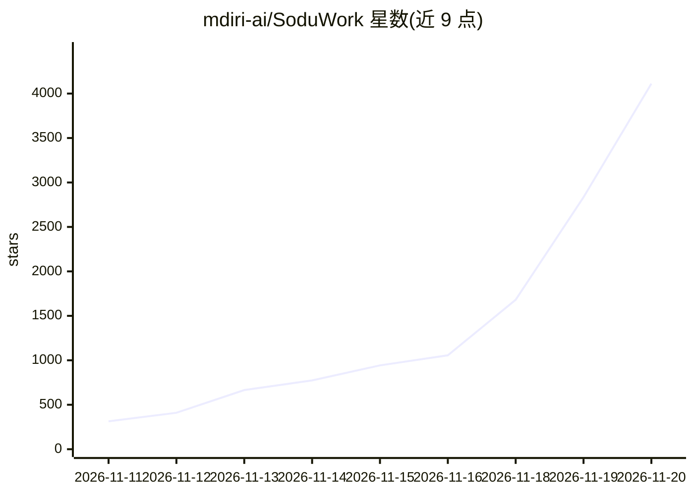

# mdiri-ai/SoduWork

⭐ 4,112 · JavaScript · MIT · 推送 2026-11-19 · [GitHub](https://github.com/mdiri-ai/SoduWork) · [官网](https://www.soduwork.ai) · 组织维护 · 中文 README

**面向团队的自托管多 harness 多 agent AI 工作引擎**

自托管的 AI 原生工作平台：以共享工单池组织请求、执行、AI 审查与签收，按步骤选择 harness 与模型，可中途切换并保留历史与工作目录。内置 Pi，通过适配器或 ACP 接入 OpenCode、DeepSeek Harness、Qwen Code、Kimi Code、Codex 等 9 种 harness。把成功任务保存为带验收标准的插件，经审核后分发给团队，提供角色、用量、成本与审计日志。需 Python 3.12+/Node.js 22.19+/Git，支持桌面客户端安装包与 Docker 部署，声明处于公测阶段。

## 筛选速览

| 维度 | 判定 | 备注 |
|---|---|---|
| AI 角色 | `ai-ecosystem` | LLM/agent 周边工具 |
| 许可风险 | `permissive` | MIT |
| 部署形态 | `desktop` | 安装包/桌面程序 |
| 模型依赖 | — | README 未给出锁定关系 |
| 硬件要求 | — | 无带数字的原话,不猜 |
| 安装摩擦 | `low` | 无编译、无系统依赖或容器化 |
| 成熟度 | `idea` | |

## 能力要点

- 统一适配接口接入 9 种 harness，支持对话中途切换并保留历史与工作目录
- 每个请求携带验收标准，由独立 AI 审查加人工签收
- 将成功任务保存为带版本与审核机制的插件，团队共享并可授权/撤销
- Docker 一键部署 Hub、管理控制台与 PostgreSQL，自托管

## 适用场景

- 团队以工单池方式协作，让不同 agent 与模型分工完成并审查任务
- 把个人有效工作方法沉淀为团队插件并统一分发管理
- 自托管部署并对 AI 用量、成本与操作留审计记录

## 场景标签

`多智能体` `编码 Agent` · 领域:Agent 开发

## 证据(README 行号)

> L153: A harness is the agent runtime that does the work. It is not the model. SoduWork connects every harness through on
> L213: - **vs. coding agent harnesses**: SoduWork doesn't replace them. It runs them as harnesses inside a team workspace

## 星数曲线

2026-11-11 314 → 2026-11-20 4,112（+3,798）

---
*卡片 v1 · prompt 1.4 · 生成 2026-11-17 · 置信度 high · 依据 README sha `75d447484d96` · [字段定义](../../DATASET.md)*
