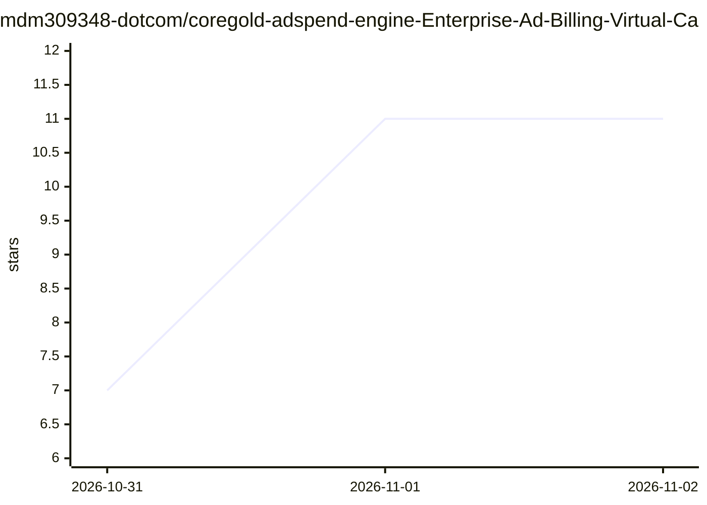

# mdm309348-dotcom/coregold-adspend-engine-Enterprise-Ad-Billing-Virtual-Cards-for-Meta-TikTok-Google-Media-Buyers

⭐ 11 · 推送 2026-10-30 · [GitHub](https://github.com/mdm309348-dotcom/coregold-adspend-engine-Enterprise-Ad-Billing-Virtual-Cards-for-Meta-TikTok-Google-Media-Buyers) · [官网](https://app.coregold.io/signup?invite_code=ADvlj9b) · 组织维护 · 中文 README

**面向海外广告投手的虚拟发卡服务推广页，非软件项目**

该仓库 README 为 CoreGold 虚拟商业卡服务的中文推广文案：宣称提供欧美企业级 Visa/Mastercard 虚拟卡，面向 Meta/TikTok/Google 广告投放人员，用于多账户独立绑卡、设置消费限额、USDT 充值与废卡资金退回。内容为营销描述与服务入口链接，不包含可安装的代码、API 文档或使用说明，主题标签中的 ai/gpt 在正文中无对应功能描述。

## 筛选速览

| 维度 | 判定 | 备注 |
|---|---|---|
| AI 角色 | `ai-enhanced` | 去掉 AI 部分产品仍成立 |
| 许可风险 | `none` | — |
| 部署形态 | `None` |  |
| 模型依赖 | — | README 未给出锁定关系 |
| 硬件要求 | — | 无带数字的原话,不猜 |
| 安装摩擦 | `low` | 无编译、无系统依赖或容器化 |
| 成熟度 | — | 结构信号不足 |

## 能力要点

- 宣称为每个 BM/广告户生成独立卡号、CVV 与账单地址
- 宣称支持单卡消费限额与 USDT 充值转美元池
- 服务对象为 Meta/TikTok/Google 买量团队

## 适用场景

- 海外多账户广告投放的独立绑卡
- 按日耗预算设置卡片限额
- 封号后回收卡内余额

## 场景标签

 · 领域:广告投放/支付服务推广

## 证据(README 行号)

> L7: > 广告风控的核心死穴就是**卡段权重（BIN Reputation）**与**支付关联链**。**CoreGold** 提供欧美直属企业级商业 Visa / Mastercard，一人一卡、一户一密，直接掐死风控源头。
> L9: 👉 **点击进入 CoreGold 投放专用发卡后台**

## 星数曲线

2026-10-31 7 → 2026-11-02 11（+4）

---
*卡片 v1 · prompt 1.4 · 生成 2026-11-02 · 置信度 low · 依据 README sha `ff06b2b4ff72` · [字段定义](../../DATASET.md)*
