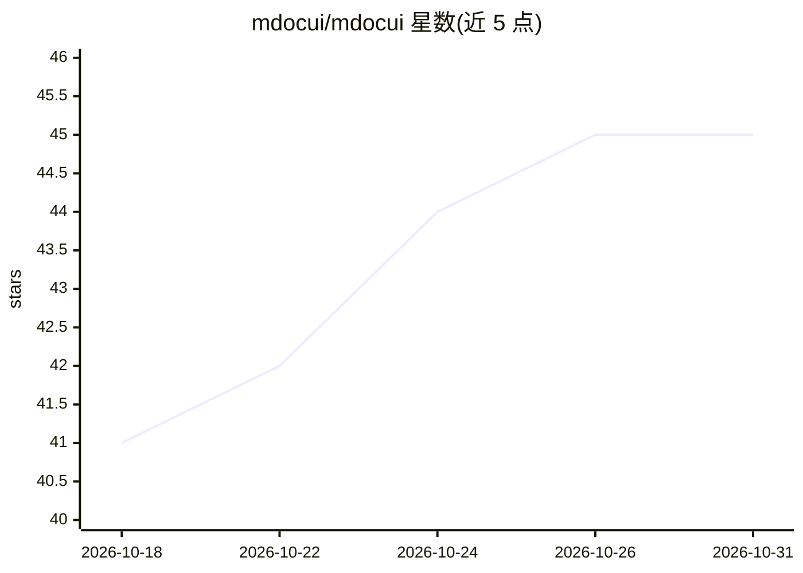

# mdocui/mdocui

⭐ 45 · TypeScript · MIT · 推送 2026-10-24 · [GitHub](https://github.com/mdocui/mdocui) · [官网](https://mdocui.github.io) · 个人维护

**面向 LLM 流式输出的生成式 UI 库，基于 Markdoc 标签语法**

让 LLM 在同一条 markdown 流中内嵌  标签输出图表、按钮、表单等交互组件的前端库。自研逐字符流式解析器将输出切分为散文节点与组件节点，组件注册表用 Zod 校验标签与 props。分为 core（解析器/提示生成）、react（渲染器、24 个默认组件）、web-components（自定义元素）、CLI（脚手架/生成系统提示）四个包；核心框架无关，React 为适配层之一。组件可用 CSS/Tailwind 定制或整体替换。处于 Alpha 阶段，API 可能在次版本间变化。

## 筛选速览

| 维度 | 判定 | 备注 |
|---|---|---|
| AI 角色 | `ai-ecosystem` | LLM/agent 周边工具 |
| 许可风险 | `permissive` | MIT |
| 部署形态 | `library` | 以包/库形式分发 |
| 模型依赖 | — | README 未给出锁定关系 |
| 硬件要求 | — | 无带数字的原话,不猜 |
| 安装摩擦 | `low` | 无编译、无系统依赖或容器化 |
| 成熟度 | `idea` | |

## 能力要点

- 自研逐字符流式解析器， 定界符适配 token 级输出
- 24 个默认组件，支持 onAction 统一交互回调与错误边界
- generatePrompt() 从组件注册表自动生成系统提示
- 提供 core/react/web-components/CLI 四个包，核心框架无关

## 适用场景

- 在聊天应用中渲染 LLM 输出的图表、表单等交互界面
- 为 LLM 流式响应构建生成式 UI 而不引入自定义 DSL
- 用自有组件替换默认组件并定制主题样式

## 场景标签

 · 领域:LLM 应用前端/UI 组件

## 证据(README 行号)

> L18: Generative UI library for LLMs using Markdoc `` tag syntax inline with markdown prose.
> L20: LLMs write natural markdown **and** drop interactive UI components in the same stream — charts, buttons, forms, tab
> L80: |`@mdocui/core`|Streaming parser, tokenizer, component registry, prompt generator|Alpha|

## 星数曲线

2026-10-18 41 → 2026-10-31 45（+4）

---
*卡片 v1 · prompt 1.4 · 生成 2026-10-25 · 置信度 high · 依据 README sha `9cbe1b38394a` · [字段定义](../../DATASET.md)*
