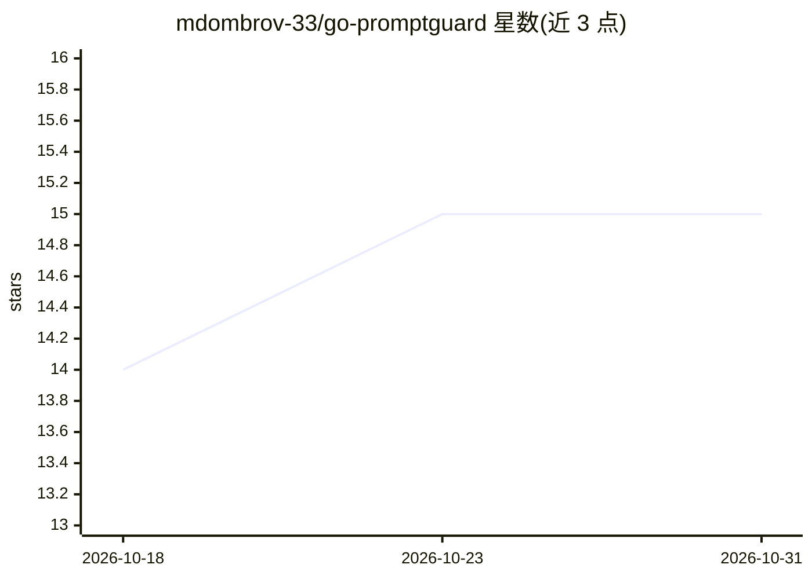

# mdombrov-33/go-promptguard

⭐ 15 · Go · MIT · 推送 2026-06-08 · [GitHub](https://github.com/mdombrov-33/go-promptguard) · [官网](https://pkg.go.dev/github.com/mdombrov-33/go-promptguard) · 个人维护

**Go 应用的 LLM 提示注入检测库与 CLI，拦截恶意输入**

面向 Go 开发者的提示注入防护工具：以多检测器组合（角色注入、指令覆盖、混淆、分隔符伪造、熵/困惑度/Token 异常等）对输入做模式匹配与统计分析，按加权评分输出风险分与安全判定，默认无 API 调用、零依赖。支持阈值调节（0.5-0.9）与可选 LLM 裁判（OpenAI/OpenRouter/Ollama，含 Always/Conditional/Fallback 三种模式）。提供 Go 库与独立 CLI（含 TUI、批处理、HTTP 服务器）。检测规则基于 Microsoft LLMail-Inject 数据集（37 万+攻击）与 OWASP LLM Top 10；README 声明不替代提示工程、输出校验等其他安全控制。

## 筛选速览

| 维度 | 判定 | 备注 |
|---|---|---|
| AI 角色 | `ai-ecosystem` | LLM/agent 周边工具 |
| 许可风险 | `permissive` | MIT |
| 部署形态 | `library` | 以包/库形式分发 |
| 模型依赖 | local-ok | 支持本地模型 |
| 硬件要求 | — | 无带数字的原话,不猜 |
| 安装摩擦 | `low` | 无编译、无系统依赖或容器化 |
| 成熟度 | — | 结构信号不足 |

## 能力要点

- 多检测器加权评分，模式匹配延迟 <1ms、零依赖（README 声明）
- 检测角色注入、指令覆盖、Base64/Unicode 混淆、分隔符伪造、多步攻击等 11 类攻击
- 可选 LLM 裁判三种运行模式（Always/Conditional/Fallback）
- 提供 Go 库、CLI（TUI/批处理/HTTP 服务）与示例工程

## 适用场景

- 在调用 LLM API 前过滤用户输入中的提示注入攻击
- 为 RAG/聊天机器人应用增加纵深防御层
- 批量检测输入文件并输出结果 JSON
- 以 HTTP 服务形式为现有系统提供检测接口

## 场景标签

`网络安全` · 领域:学习与行业

## 证据(README 行号)

> L7: Detect prompt injection attacks in Go applications. Block malicious inputs before they reach your LLM.
> L317: - Pre-filtering user input before LLM APIs

## 星数曲线

2026-10-18 14 → 2026-10-31 15（+1）

---
*卡片 v1 · prompt 1.4 · 生成 2026-10-30 · 置信度 high · 依据 README sha `0a7e8dbc84e6` · [字段定义](../../DATASET.md)*
