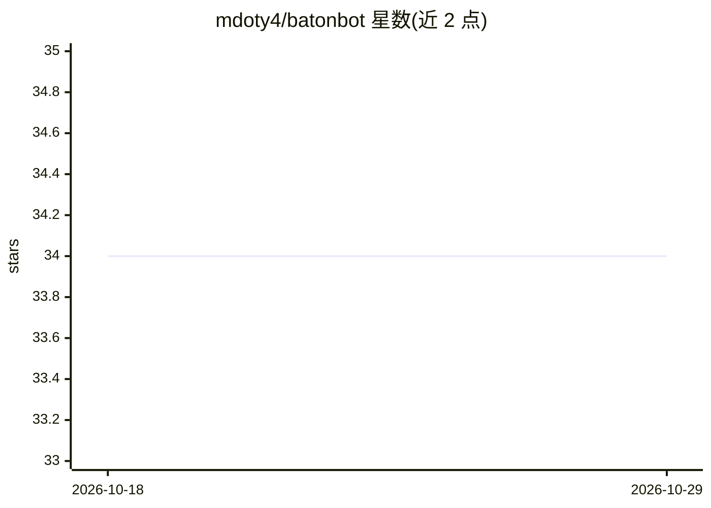

# mdoty4/batonbot

⭐ 34 · JavaScript · MIT · 推送 2026-08-10 · [GitHub](https://github.com/mdoty4/batonbot) · [官网](https://batonbot.com) · 个人维护

**本地优先的 AI 工作流编排器：串联模型、agent 与脚本**

面向开发者的本地优先工作流编排工具：将提示词、agent 与 OpenAI 兼容 LLM 调用编排为可重复执行的流水线。提供看板与线性 Pipeline 两种编辑视图，任务卡片可在队列中排序，每步指派不同 agent（内置 baton-code，或外部 Aider、Cline、Telegram），通过 SSE 实时跟踪状态并支持播放/暂停/取消。LLM 请求可路由到 LM Studio 等本地服务器或企业 API；所有交互以 JSON 记录。提供 Windows/macOS 便携包、源码运行与 Docker 部署；项目当前处于临时开发暂停状态。

## 筛选速览

| 维度 | 判定 | 备注 |
|---|---|---|
| AI 角色 | `ai-ecosystem` | LLM/agent 周边工具 |
| 许可风险 | `permissive` | MIT |
| 部署形态 | `desktop` | 安装包/桌面程序 |
| 模型依赖 | — | README 未给出锁定关系 |
| 硬件要求 | — | 无带数字的原话,不猜 |
| 安装摩擦 | `low` | 无编译、无系统依赖或容器化 |
| 成熟度 | — | 结构信号不足 |

## 能力要点

- 看板/流水线视图编排多 agent 任务序列，SSE 实时状态跟踪与播放/暂停/取消控制
- 内置 baton-code agent，并支持 Aider、Cline、Telegram 作为可路由 agent
- LLM 请求可路由本地服务器（LM Studio）或企业 API，按项目覆盖配置
- 提供 REST API、SSE 流与 OpenClaw skill.md 集成

## 适用场景

- 把重复的多步 AI 编码任务固化为可一键执行的流水线
- 在同一序列中按任务分派不同 coding agent（Aider/Cline 等）
- 本地 LM Studio 运行模型以控制成本与隐私

## 场景标签

`多智能体` `工作流自动化` · 领域:Agent 开发

## 证据(README 行号)

> L5: BatonBot is a local-first workflow orchestrator for chaining prompts, agents, and OpenAI-compatible LLM calls into r
> L21: - **Native + External Agents**: First-class native agents (`baton-code`, `baton-code-thinking`) plus support for **
> L22: - **Hybrid LLM Support**: Route requests through local servers (LM Studio) for privacy and cost, or connect to ente

## 星数曲线

2026-10-18 34 → 2026-10-29 34（+0）

---
*卡片 v1 · prompt 1.4 · 生成 2026-10-25 · 置信度 high · 依据 README sha `42c13ab92cc6` · [字段定义](../../DATASET.md)*
