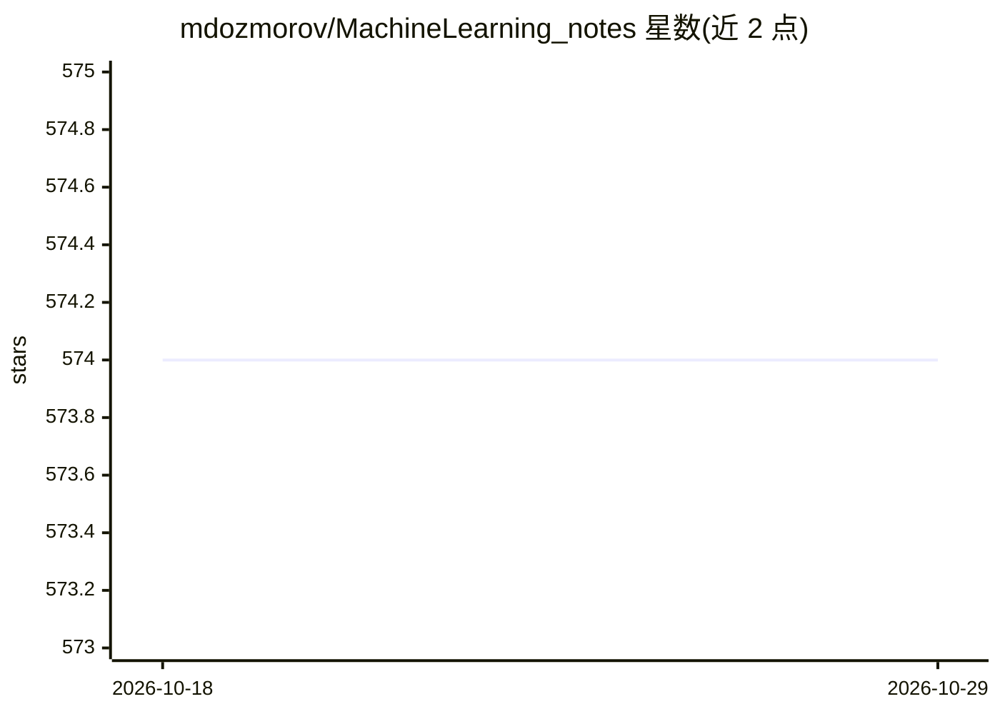

# mdozmorov/MachineLearning_notes

⭐ 574 · MIT · 推送 2026-10-22 · [GitHub](https://github.com/mdozmorov/MachineLearning_notes) · 个人维护

**机器学习/深度学习学习资源策展清单（速查表、教程、书籍）**

个人维护的 ML/DL 资源聚合仓库，MIT 许可、接受 PR 贡献。按主题组织条目：速查表、Awesome 清单、Keras/TensorFlow 与 PyTorch 教程、JAX、图神经网络、Transformers、深度学习书籍等，多为指向外部课程、Jupyter notebook、视频与书籍的链接，含部分 R 语言材料；另提及配套的 MDmisc 笔记仓库覆盖编程与基因组学。本体不含代码，仅做链接编目。

## 筛选速览

| 维度 | 判定 | 备注 |
|---|---|---|
| AI 角色 | `ai-knowledge` | 知识聚合/清单类 |
| 许可风险 | `permissive` | MIT |
| 部署形态 | `library` | 以包/库形式分发 |
| 模型依赖 | — | README 未给出锁定关系 |
| 硬件要求 | — | 无带数字的原话,不猜 |
| 安装摩擦 | `medium` | 含编译或系统依赖之一 |
| 成熟度 | — | 结构信号不足 |

## 能力要点

- 覆盖速查表、Awesome 清单、教程、书籍等多类资源
- 按 Keras/TensorFlow、PyTorch、JAX、GNN、Transformers 等主题分节
- 条目多为外部课程、notebook、视频与书籍链接

## 适用场景

- 系统查找机器学习与深度学习的入门与进阶资料
- 按框架（TensorFlow/PyTorch/JAX）定位配套教程与 notebook
- 收集速查表与面试准备材料

## 场景标签

`精选清单` · 领域:学习与行业

## 证据(README 行号)

> L5: Machine and AI/deep learning and data analysis resources. Please, contribute and get in touch! See MDmisc notes for 
> L13: - Artificial-intelligence - Awesome AI Learning with +100 AI Cheat-Sheets, Free online Books, Top Courses, Best Vid
> L71: ## Keras, Tensorflow

## 星数曲线

2026-10-18 574 → 2026-10-29 574（+0）

---
*卡片 v1 · prompt 1.4 · 生成 2026-10-21 · 置信度 mid · 依据 README sha `7e20ec6f513a` · [字段定义](../../DATASET.md)*
