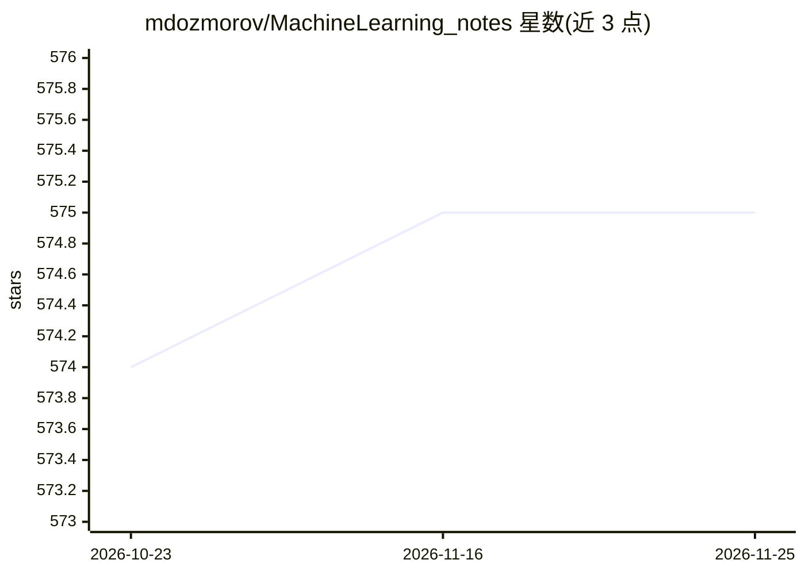

# mdozmorov/MachineLearning_notes

⭐ 575 · MIT · 推送 2026-10-29 · [GitHub](https://github.com/mdozmorov/MachineLearning_notes) · 个人维护

**机器学习与深度学习资源笔记清单：教程/书籍/速查表汇总**

以 Markdown 笔记形式维护的机器学习、深度学习与数据分析资源汇总清单，按速查表、Awesome 列表、Keras/TensorFlow、PyTorch、JAX、图神经网络、Transformers、深度学习书籍等章节组织，每条为指向外部教程、课程、书籍或代码仓库的链接与简介。MIT 许可，接受 PR 贡献。维护者另有基因组学相关编程笔记仓库。无安装运行步骤，使用方式为阅读与点击链接。

## 筛选速览

| 维度 | 判定 | 备注 |
|---|---|---|
| AI 角色 | `ai-knowledge` | 知识聚合/清单类 |
| 许可风险 | `permissive` | MIT |
| 部署形态 | `library` | 以包/库形式分发 |
| 模型依赖 | — | README 未给出锁定关系 |
| 硬件要求 | — | 无带数字的原话,不猜 |
| 安装摩擦 | `medium` | 含编译或系统依赖之一 |
| 成熟度 | — | 结构信号不足 |

## 能力要点

- 按框架（Keras/TensorFlow、PyTorch、JAX）与主题（图神经网络、Transformers）分章节组织资源
- 收录速查表、在线课程、书籍配套代码与 Awesome 列表等多类型链接
- MIT 许可并接受社区 PR 贡献

## 适用场景

- 为入门或进阶机器学习查找教程与课程链接
- 需要某框架（TensorFlow/PyTorch/JAX）学习材料时按章节检索
- 准备面试或复习时查阅速查表与书籍资源

## 场景标签

`精选清单` · 领域:学习与行业

## 证据(README 行号)

> L5: Machine and AI/deep learning and data analysis resources. Please, contribute and get in touch! See MDmisc notes for 
> L11: # Cheatsheets

## 星数曲线

2026-10-23 574 → 2026-11-25 575（+1）

---
*卡片 v1 · prompt 1.4 · 生成 2026-11-25 · 置信度 mid · 依据 README sha `a13048994139` · [字段定义](../../DATASET.md)*
