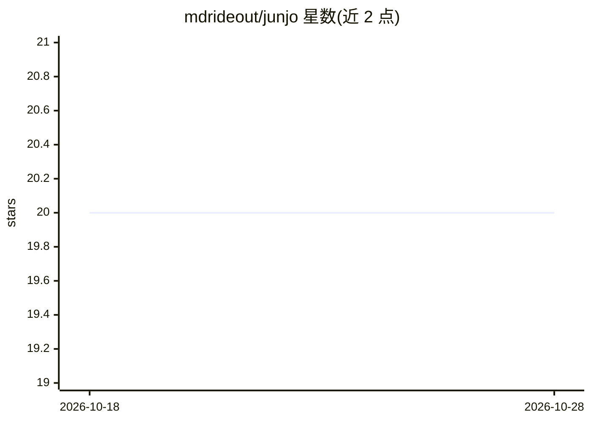

# mdrideout/junjo

⭐ 20 · Python · Apache-2.0 · 推送 2026-10-08 · [GitHub](https://github.com/mdrideout/junjo) · [官网](https://python-api.junjo.ai/) · 个人维护

**构建可观测 AI 应用与确定性工作流的平台与 Python SDK**

Junjo 是一个构建可观测 AI 应用的平台，通过显式契约管理确定性工作流、自主行为与诊断工具。仓库为 monorepo，包含独立构建与版本化的组件：junjo Python SDK（含示例与 API 导出契约）、Junjo AI Studio 后端/前端/摄取服务及部署分发、产品文档网站、Codex 插件与 telemetry 契约 schema。各组件相互独立、不构成运行时依赖，统一以 Apache 2.0 许可发布。开发通过 uv 从各组件目录运行命令，并可用脚本做跨层端到端验证。

## 筛选速览

| 维度 | 判定 | 备注 |
|---|---|---|
| AI 角色 | `ai-ecosystem` | LLM/agent 周边工具 |
| 许可风险 | `permissive` | Apache-2.0 |
| 部署形态 | `None` |  |
| 模型依赖 | — | README 未给出锁定关系 |
| 硬件要求 | — | 无带数字的原话,不猜 |
| 安装摩擦 | `low` | 无编译、无系统依赖或容器化 |
| 成熟度 | — | 结构信号不足 |

## 能力要点

- Python SDK 与 AI Studio（后端/前端/摄取服务/部署分发）等多个独立版本化组件
- 语言无关的 telemetry 契约 schema 与一致性 fixtures
- 提供本地 Studio 端到端验证脚本与隔离测试身份
- 全部组件以 Apache License 2.0 许可

## 适用场景

- 用 Python SDK 构建由 LLM 驱动的图/DAG 工作流
- 部署 Junjo AI Studio 做可观测 AI 应用
- 跨 SDK 与 Studio 共享遥测契约做一致性验证

## 场景标签

`工作流自动化` `LLM 可观测性` · 领域:效率与自动化

## 证据(README 行号)

> L3: Examples and integrations — including a native Junjo Agent with the OpenAI SDK, OpenInference, and composable applic
> L5: Junjo is a platform for building observable AI applications whose deterministic
> L6: workflows, autonomous behavior, and diagnostic tooling evolve through explicit

## 星数曲线

2026-10-18 20 → 2026-10-28 20（+0）

---
*卡片 v1 · prompt 1.4 · 生成 2026-10-28 · 置信度 mid · 依据 README sha `5604dee741aa` · [字段定义](../../DATASET.md)*
