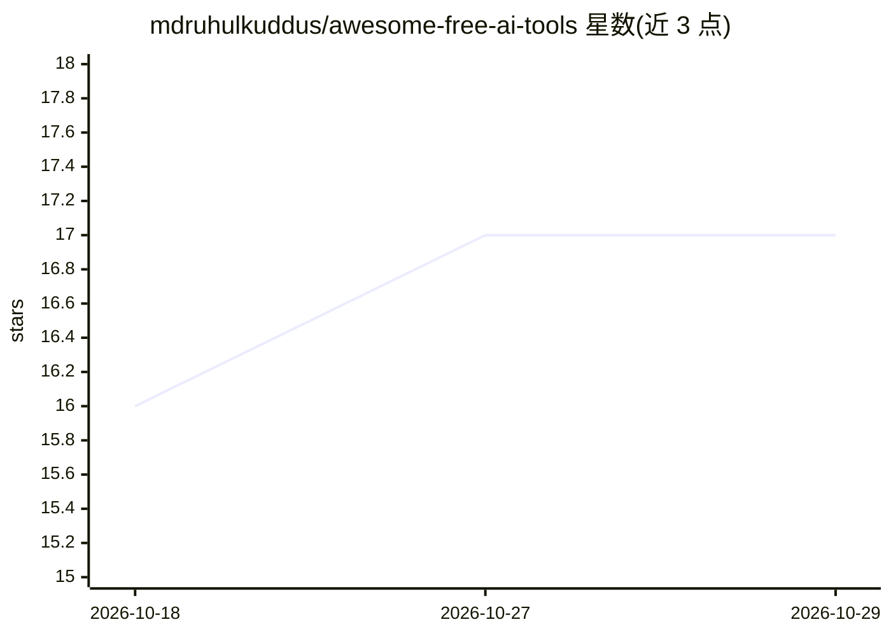

# mdruhulkuddus/awesome-free-ai-tools

⭐ 17 · CSS · MIT · 推送 2026-04-24 · [GitHub](https://github.com/mdruhulkuddus/awesome-free-ai-tools) · [官网](https://mdruhulkuddus.github.io/awesome-free-ai-tools/) · 个人维护

**免费 AI 工具策展清单：230+ 工具按 35+ 类别整理免费额度**

个人维护的 awesome 清单，收录 230+ 个提供真实免费额度的 AI 工具，覆盖聊天助手、研究搜索、写作、PDF 对话、笔记知识管理、会议转录等 35+ 类别。对头部聊天机器人（Claude/ChatGPT/Gemini）给出免费额度、上下文窗口、功能对比表；每条目统一格式列出免费限制、适用场景与付费门槛，标注最后更新日期。条目以闭源免费层与开源项目混合收录，面向最终用户选型参考，不提供软件本体。

## 筛选速览

| 维度 | 判定 | 备注 |
|---|---|---|
| AI 角色 | `ai-knowledge` | 知识聚合/清单类 |
| 许可风险 | `permissive` | MIT |
| 部署形态 | `None` |  |
| 模型依赖 | — | README 未给出锁定关系 |
| 硬件要求 | — | 无带数字的原话,不猜 |
| 安装摩擦 | `medium` | 含编译或系统依赖之一 |
| 成熟度 | — | 结构信号不足 |

## 能力要点

- 230+ 免费工具按 35+ 类别组织
- Top 3 聊天机器人免费层并排对比表（模型/限额/上下文/功能）
- 每条目统一标注 Free 额度、Best for 与 Catch（付费门槛）

## 适用场景

- 挑选日常可用的免费 AI 聊天助手
- 查找有真实免费额度的研究、写作或 PDF 工具
- 对比各产品免费层的限额与功能差异

## 场景标签

`精选清单` · 领域:学习与行业

## 证据(README 行号)

> L25: A curated, opinionated list of the best **genuinely free** AI tools available right now — real free tiers, open-sou
> L3: Awesome Free AI Tools — 230+ genuinely free AI tools

## 星数曲线

2026-10-18 16 → 2026-10-29 17（+1）

---
*卡片 v1 · prompt 1.4 · 生成 2026-10-29 · 置信度 high · 依据 README sha `a6df73fc7525` · [字段定义](../../DATASET.md)*
