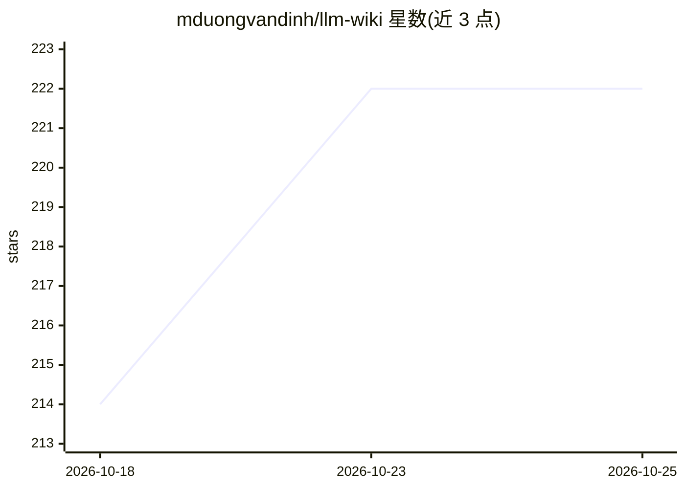

# mduongvandinh/llm-wiki

⭐ 222 · HTML · MIT · 推送 2026-04-16 · [GitHub](https://github.com/mduongvandinh/llm-wiki) · 个人维护

**由 LLM 自动构建与维护的个人知识库系统**

基于 Andrej Karpathy 的 LLM Wiki 模式：把文章、笔记、PDF 或 Reddit 帖子放入 raw/ 目录，由 AI 编码助手执行 discover→ingest→lint 循环，抽取实体与概念生成带交叉引用的 wiki 页面（每源约 5-15 页），标记来源间矛盾并持续维护。主要支持 Claude Code（含 /llm-wiki 技能与 /loop 自动运行），兼容 Cursor、Copilot、Windsurf、Gemini CLI、Codex 等。仓库为文件夹+markdown 结构，无需向量库，可用 Obsidian 浏览；运行成本约每周期 $0.10-0.40。

## 筛选速览

| 维度 | 判定 | 备注 |
|---|---|---|
| AI 角色 | `ai-native` | 本体是模型或模型工具 |
| 许可风险 | `permissive` | MIT |
| 部署形态 | `None` |  |
| 模型依赖 | locked-api |  |
| 硬件要求 | — | 无带数字的原话,不猜 |
| 安装摩擦 | `low` | 无编译、无系统依赖或容器化 |
| 成熟度 | — | 结构信号不足 |

## 能力要点

- discover/ingest/query/lint 四工作流自动发现来源并维护知识库
- 每个来源生成 5-15 个带交叉引用的 wiki 页面并标记矛盾
- 提供 book-companion、competitive-intel、job-search 等预置变体
- 兼容 Claude Code、Cursor、Copilot、Gemini CLI 等多种 AI 编码助手

## 适用场景

- 把零散文章和笔记自动整理成结构化可查询的 wiki
- 读书时自动抽取人物、时间线、设定构建伴随 wiki
- 持续追踪竞品定价与功能变化并生成 battlecard
- 团队以共享 Git 仓库协作维护知识库

## 场景标签

`知识库管理` · 领域:知识与检索

## 证据(README 行号)

> L5: Drop articles, notes, PDFs, or Reddit threads into a folder. Your AI reads everything, builds a structured wiki with
> L62: ### Claude Code

## 星数曲线

2026-10-18 214 → 2026-10-25 222（+8）

---
*卡片 v1 · prompt 1.4 · 生成 2026-10-23 · 置信度 high · 依据 README sha `4fe6c1f72ada` · [字段定义](../../DATASET.md)*
