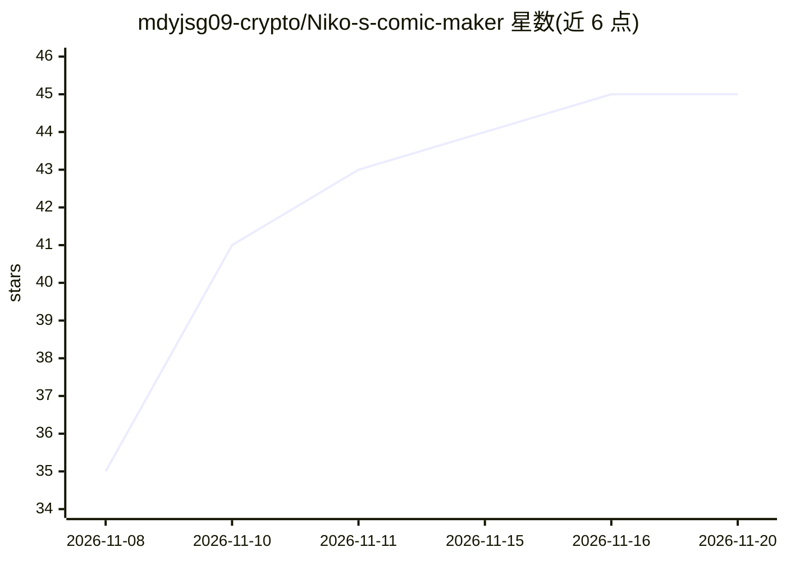

# mdyjsg09-crypto/Niko-s-comic-maker

⭐ 45 · Python · NOASSERTION · 推送 2026-11-14 · [GitHub](https://github.com/mdyjsg09-crypto/Niko-s-comic-maker) · 个人维护

**用本地 ComfyUI 从一句话生成日式彩色页漫画的个人工具**

个人实验项目：用户用韩语一句话描述想要的漫画，外部 AI 聊天（ChatGPT/Gemini 或本地模型）生成故事计划 plan.yaml，本工具转为分镜 conti.yaml，再由本机 ComfyUI（Anima 模型）逐格绘图，经自动检视（可选 Ollama 视觉模型）、对白气泡与页面拼版后输出 PNG/PDF 及离线网页版。面向 Windows 10/11 + NVIDIA GPU（8GB 测试通过）用户，界面与文档仅韩语；许可证为 PolyForm Noncommercial 1.0.0，仅限非商业用途，首次运行须同意使用政策（仅限全年龄内容）。

## 筛选速览

| 维度 | 判定 | 备注 |
|---|---|---|
| AI 角色 | `ai-native` | 本体是模型或模型工具 |
| 许可风险 | `none` | NOASSERTION |
| 部署形态 | `desktop` | 安装包/桌面程序 |
| 模型依赖 | local-ok | 支持本地模型 |
| 硬件要求 | — | 无带数字的原话,不猜 |
| 安装摩擦 | `low` | 无编译、无系统依赖或容器化 |
| 成熟度 | `idea` | |

## 能力要点

- AI 聊天写计划 → 分镜 → ComfyUI 绘图 → 检视 → 排版的端到端流程
- 输出页漫画 PNG/PDF、封面与离线网页版（webtoon HTML）
- 依赖本地 ComfyUI 与 Anima/Anima-LLLite/SAM 3.1 模型（合计约 7.4GB）
- 可选 Ollama 视觉模型做自动检视与本地计划生成

## 适用场景

- 把一句话的漫画构想变成带对白气泡的彩色页漫画
- 重新绘制个别分镜或修改对白后重排版
- 生成可在手机上竖向阅读的离线网页版漫画

## 场景标签

`图像生成` · 领域:内容生成

## 证据(README 行号)

> L41: 요청(한국어 자유 문장) ─► AI 채팅이 계획표 plan.yaml ─► nk가 콘티 conti.yaml로 (연출 규칙은 코드가 붙임)
> L158: Request (free-form sentence) ─► an AI chat (any LLM) writes plan.yaml ─► nk turns it into the storyboard conti.yam

## 星数曲线

2026-11-08 35 → 2026-11-20 45（+10）

---
*卡片 v1 · prompt 1.4 · 生成 2026-11-18 · 置信度 high · 依据 README sha `75b13dcf0eaa` · [字段定义](../../DATASET.md)*
