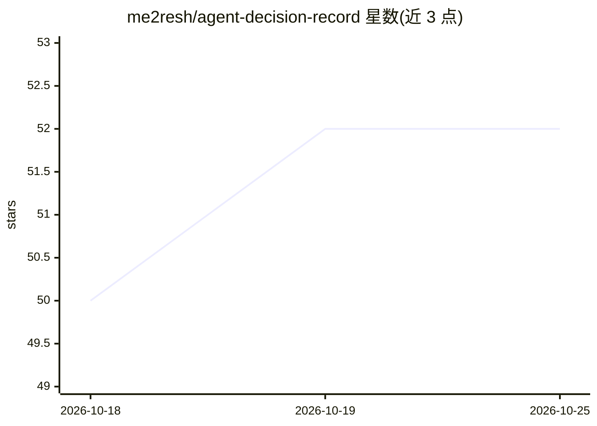

# me2resh/agent-decision-record

⭐ 52 · JavaScript · NOASSERTION · 推送 2026-09-26 · [GitHub](https://github.com/me2resh/agent-decision-record) · 个人维护

**记录 AI 编码代理技术决策的开放标准（AgDR）**

Agent Decision Record（AgDR）是面向 AI 辅助开发的决策记录开放标准：由编码代理（Claude Code、Codex、Copilot、Cursor、Windsurf 等）在做出选库、架构等技术决策的当下生成结构化 Markdown 文件，含上下文、候选方案、决策与接受的权衡，并携带模型、触发方式、时间戳等元数据，随代码提交到 docs/agdr/。标准提供模板、Markdown 与 JSON 双表示、Schema 及 CI 校验脚本，并为各主流代理提供技能/规则/插件集成。采用 CC BY 4.0 许可。

## 筛选速览

| 维度 | 判定 | 备注 |
|---|---|---|
| AI 角色 | `ai-knowledge` | 知识聚合/清单类 |
| 许可风险 | `none` | NOASSERTION |
| 部署形态 | `library` | 以包/库形式分发 |
| 模型依赖 | locked-api |  |
| 硬件要求 | — | 无带数字的原话,不猜 |
| 安装摩擦 | `low` | 无编译、无系统依赖或容器化 |
| 成熟度 | — | 结构信号不足 |

## 能力要点

- 代理实时生成含元数据（模型/触发/时间戳）的结构化决策记录
- 提供 Markdown + JSON 双表示与 Schema，CI 可自动校验格式
- 零依赖路径：复制模板、Schema、校验脚本三件文件即可采用
- 为 Claude Code、Codex、Cursor、Copilot、Windsurf 提供集成工具

## 适用场景

- 让 AI 编码代理的选型与架构决策留下可追溯的记录
- 团队审计 PR 中代理决策的依据与权衡
- 新成员通过 AgDR 还原 AI 时代的技术决策背景

## 场景标签

 · 领域:软件工程/开发标准

## 证据(README 行号)

> L15: **An Agent Decision Record (AgDR) is that missing record.** It's a small, structured Markdown file — context, the o
> L17: It's an open standard: a Markdown representation, a JSON serialisation, schemas for both, and validators that CI ru

## 星数曲线

2026-10-18 50 → 2026-10-25 52（+2）

---
*卡片 v1 · prompt 1.4 · 生成 2026-10-24 · 置信度 high · 依据 README sha `d82fbe97ae9b` · [字段定义](../../DATASET.md)*
