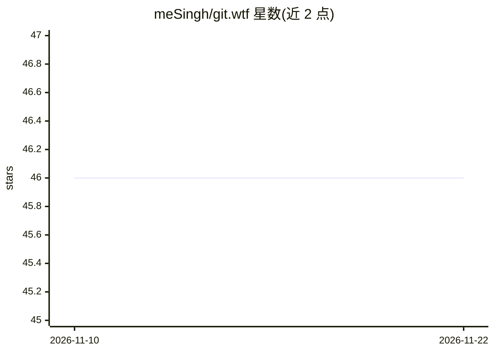

# meSingh/git.wtf

⭐ 46 · TypeScript · 推送 2026-11-09 · [GitHub](https://github.com/meSingh/git.wtf) · [官网](https://git.wtf) · 个人维护

**记录 Git 与 AI 翻车事故的天数计数器与漫画网站**

一个建立在真实事故之上的幽默/恶搞网站：以文件形式收录 2016 年起的 Git 与 AI 相关事故，每条含日期、来源 URL、摘要与事实面板，正文分三段讲述发生/原因/结局；首页计数器在浏览器（IST 时区）计算距最近一次事故的天数。每个事故配一段带卡通音效的 SVG 动画场景（GSAP 动效，Astro 构建，Cloudflare Workers 部署），并保留旧博客文章于 /archive/，含旧 URL 重定向与 CI 校验。提供 npm 本地开发与发布脚本。

## 筛选速览

| 维度 | 判定 | 备注 |
|---|---|---|
| AI 角色 | `ai-knowledge` | 知识聚合/清单类 |
| 许可风险 | `none` | — |
| 部署形态 | `library` | 以包/库形式分发 |
| 模型依赖 | — | README 未给出锁定关系 |
| 硬件要求 | — | 无带数字的原话,不猜 |
| 安装摩擦 | `low` | 无编译、无系统依赖或容器化 |
| 成熟度 | — | 结构信号不足 |

## 能力要点

- incidents/ 下按文件管理事故，计数器在浏览器端计算天数
- 每个事故配 SVG 卡通动画场景与音效
- 旧博客内容从 Internet Archive 与 Ghost 导入并保留原 URL 重定向
- npm 脚本校验旧 URL、渲染静帧并在 CI 中检查

## 适用场景

- 浏览真实 Git/AI 事故的漫画化复盘
- 查看距上次行业事故的天数计数
- 访问 2016-2025 年的 Git 修复旧文存档

## 场景标签

`精选清单` · 领域:学习与行业

## 证据(README 行号)

> L5: A counter for the days since the last Git and AI fuck-up, and a short cartoon episode for every real incident that r
> L11: - `incidents/YYYY-MM-DD-slug.md`: one file per incident. Front matter: `date`, `title`, `category`, `source_url`, `

## 星数曲线

2026-11-10 46 → 2026-11-22 46（+0）

---
*卡片 v1 · prompt 1.4 · 生成 2026-11-18 · 置信度 mid · 依据 README sha `8c15be7d47b3` · [字段定义](../../DATASET.md)*
