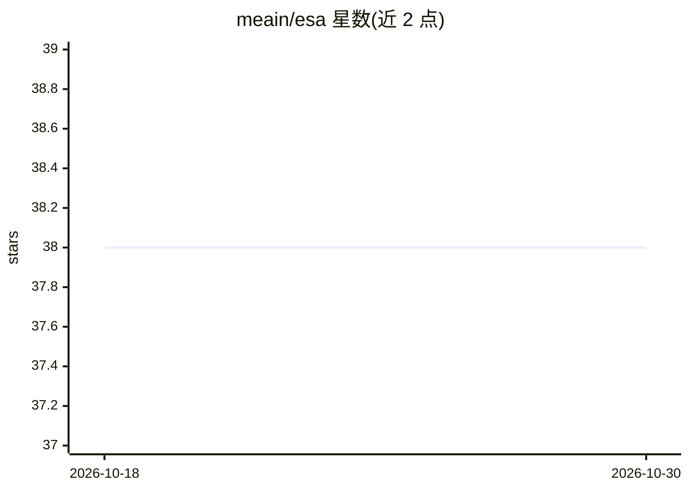

# meain/esa

⭐ 38 · Go · Apache-2.0 · 推送 2026-04-24 · [GitHub](https://github.com/meain/esa) · [官网](https://blog.meain.io/2025/building-personalized-micro-agents/) · 个人维护

**让开发者用自然语言创建个性化 AI agent 的命令行工具**

ESA 是 Go 编写的命令行工具，将 LLM 与 shell 脚本函数连接，使用户通过自然语言控制系统、自动化任务和查询信息。支持 OpenAI、Anthropic、Groq、Ollama、OpenRouter、GitHub Models 及自定义 OpenAI 兼容 API 等多种提供商。用户可通过 TOML 配置文件定义专门 agent（如 k8s、git、jira），内置 +default/+new/+auto 三个 agent。提供 REPL 交互模式与浏览器 Web 聊天界面，含确认级别与 safe/unsafe 命令分类等安全机制。

## 筛选速览

| 维度 | 判定 | 备注 |
|---|---|---|
| AI 角色 | `ai-native` | 本体是模型或模型工具 |
| 许可风险 | `permissive` | Apache-2.0 |
| 部署形态 | `library` | 以包/库形式分发 |
| 模型依赖 | local-ok | 支持本地模型 |
| 硬件要求 | — | 无带数字的原话,不猜 |
| 安装摩擦 | `low` | 无编译、无系统依赖或容器化 |
| 成熟度 | — | 结构信号不足 |

## 能力要点

- 通过 TOML 配置将 shell 脚本定义为 LLM 可调用的函数
- 支持 OpenAI/Anthropic/Groq/Ollama/OpenRouter/GitHub Models 等多提供商
- 内置 REPL 交互模式与 WebSocket 流式 Web 聊天界面
- 三级命令确认机制与 safe/unsafe 函数安全分类

## 适用场景

- 用自然语言执行系统操作与自动化任务
- 为 DevOps、Git、编码等领域创建专门 agent
- 通过浏览器界面进行对话式命令执行与审批

## 场景标签

`Agent 框架` `工作流自动化` · 领域:Agent 开发

## 证据(README 行号)

> L7: **ESA** is an AI-powered command-line tool that lets you create powerful personalized small agents. By connecting La
> L13: - **Multi-Provider LLM Support**: Works with OpenAI, Anthropic, Groq, Ollama, OpenRouter, GitHub Models, and custom

## 星数曲线

2026-10-18 38 → 2026-10-30 38（+0）

---
*卡片 v1 · prompt 1.4 · 生成 2026-10-25 · 置信度 high · 依据 README sha `24520b49e6ec` · [字段定义](../../DATASET.md)*
