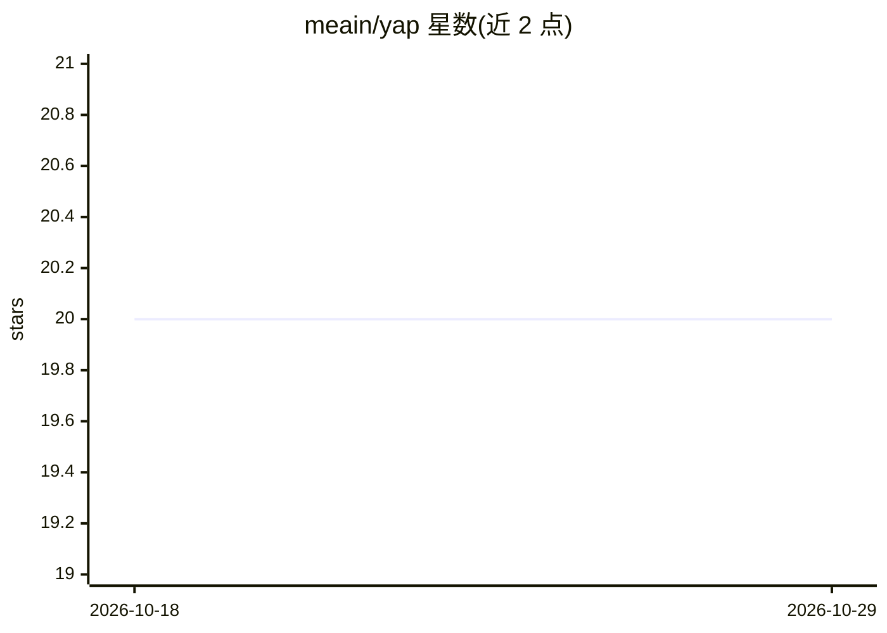

# meain/yap

⭐ 20 · Emacs Lisp · 推送 2026-03-11 · [GitHub](https://github.com/meain/yap) · 个人维护

**Emacs 包：用模板向 LLM 提问并按回复改写缓冲区**

面向 Emacs 用户的 LLM 交互包：提供预定义提示模板（如 summarize、explain-code、optimize-code、generate-shell-command），通过 yap-prompt / yap-rewrite / yap-write 三个命令获取模型回复、改写选区或整个缓冲区、或原位插入内容。支持 OpenAI、Anthropic 与 Ollama 三种服务，可自定义三级模板（字符串、内置辅助函数、完全自定义消息链）。通过 use-package/straight 或 package-vc-install 安装。README 声明仍处于早期开发阶段，界面可能变动。

## 筛选速览

| 维度 | 判定 | 备注 |
|---|---|---|
| AI 角色 | `ai-native` | 本体是模型或模型工具 |
| 许可风险 | `none` | — |
| 部署形态 | `None` |  |
| 模型依赖 | local-ok | 支持本地模型 |
| 硬件要求 | — | 无带数字的原话,不猜 |
| 安装摩擦 | `low` | 无编译、无系统依赖或容器化 |
| 成熟度 | `idea` | |

## 能力要点

- yap-prompt / yap-rewrite / yap-write 三种调用方式覆盖提问、改写与插入
- 支持 OpenAI、Anthropic 与 Ollama 服务
- 三级自定义模板体系（字符串模板/内置辅助函数/自定义消息链）
- 模板内 {{name}} 占位符自动转为交互式输入

## 适用场景

- 在 Emacs 中对选中文本做总结、解释或优化改写
- 为函数或模块生成文档
- 在 shell 缓冲区生成所需命令

## 场景标签

`AI 写作` `AI 助手` · 领域:对话与助手

## 证据(README 行号)

> L3: `yap` is an Emacs package designed to facilitate interactions with
> L24: - **Prompt Templates**: Easily call predefined templates for common tasks.
> L56: - `yap-prompt`: Prompt the LLM with a selected template.

## 星数曲线

2026-10-18 20 → 2026-10-29 20（+0）

---
*卡片 v1 · prompt 1.4 · 生成 2026-10-28 · 置信度 high · 依据 README sha `b5542cceaa41` · [字段定义](../../DATASET.md)*
