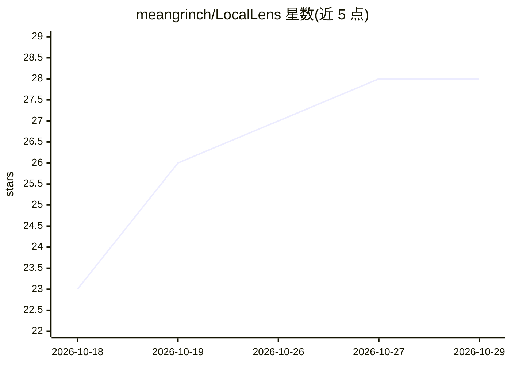

# meangrinch/LocalLens

⭐ 28 · Python · Apache-2.0 · 推送 2026-10-23 · [GitHub](https://github.com/meangrinch/LocalLens) · 个人维护

**本地图片/视频离线语义搜索引擎：自然语言查找与以图搜图**

离线视觉搜索引擎：递归索引本地目录到 ChromaDB，使用 EmbeddingGemma 2、SigLIP 2 等视觉嵌入模型，支持自然语言文本检索、上传图片的反向搜索及文本+图片组合查询，并可按相似度阈值查找重复/近似重复的图片与视频。提供 Gradio Web UI 与 CLI 两种界面，支持增量同步。Windows 提供免依赖便携包，Linux/macOS 需 Python 3.11+ 与 Git，亦可从源码安装（含 CUDA 或 CPU 版 PyTorch 可选路径）。

## 筛选速览

| 维度 | 判定 | 备注 |
|---|---|---|
| AI 角色 | `ai-native` | 本体是模型或模型工具 |
| 许可风险 | `permissive` | Apache-2.0 |
| 部署形态 | `library` | 以包/库形式分发 |
| 模型依赖 | — | README 未给出锁定关系 |
| 硬件要求 | — | 无带数字的原话,不猜 |
| 安装摩擦 | `low` | 无编译、无系统依赖或容器化 |
| 成熟度 | — | 结构信号不足 |

## 能力要点

- 自然语言、图片及文本+图片组合的相似度检索
- 按相似度阈值查找重复与近似重复的图片/视频
- 视觉嵌入模型可选 EmbeddingGemma 2 与 SigLIP 2，EmbeddingGemma 2 可调 Image Detail（70-1120 soft tokens）
- 递归目录索引与增量同步（ChromaDB），Gradio Web UI 与 CLI 双界面

## 适用场景

- 用一句描述在本地相册中找到对应照片或视频
- 上传一张图找出视觉相似的其他文件
- 清理重复或近似重复的图片/视频

## 场景标签

`语义搜索` · 领域:知识与检索

## 证据(README 行号)

> L7: An offline visual search engine for local image and video collections. Indexes directories into ChromaDB using visio
> L53: - **Models**: Vision embedding backbones (EmbeddingGemma 2, SigLIP 2)

## 星数曲线

2026-10-18 23 → 2026-10-29 28（+5）

---
*卡片 v1 · prompt 1.4 · 生成 2026-10-26 · 置信度 mid · 依据 README sha `b3cad5b49cdd` · [字段定义](../../DATASET.md)*
