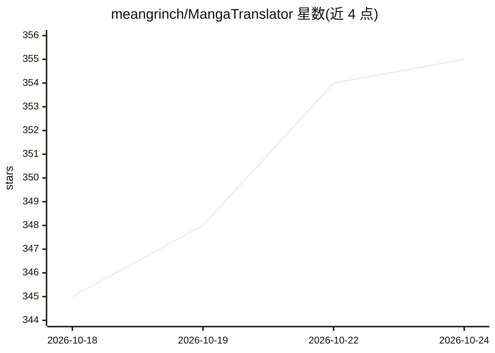

# meangrinch/MangaTranslator

⭐ 355 · Python · Apache-2.0 · 推送 2026-10-23 · [GitHub](https://github.com/meangrinch/MangaTranslator) · 个人维护

**一键翻译漫画/韩漫/国漫页面的桌面应用，支持 60+ 语言**

面向漫画读者的自动化翻译应用：检测气泡内与气泡外文本（YOLO、SAM 2.1/3），用扩散模型 inpainting（FLUX.2 Klein / FLUX.1 Kontext）或 OpenCV 还原背景，经 OCR 与 LLM 翻译为 60+ 语言后用自定义字体排版嵌回页面，另提供文字区域与整页放大。翻译后端可在 Web UI 中选择云服务商（Google、OpenAI、Anthropic、DeepSeek 等）或本地 OpenAI 兼容端点。提供便携包（Windows 无额外要求，Linux/macOS 需 Python 3.10+ 与 Git）与源码安装两种方式，界面含 Gradio Web UI 与 CLI，支持单图、文件夹与 ZIP/CBZ 批量处理。

## 筛选速览

| 维度 | 判定 | 备注 |
|---|---|---|
| AI 角色 | `ai-native` | 本体是模型或模型工具 |
| 许可风险 | `permissive` | Apache-2.0 |
| 部署形态 | `library` | 以包/库形式分发 |
| 模型依赖 | — | README 未给出锁定关系 |
| 硬件要求 | — | 无带数字的原话,不猜 |
| 安装摩擦 | `low` | 无编译、无系统依赖或容器化 |
| 成熟度 | — | 结构信号不足 |

## 能力要点

- 语音气泡与气泡外文本检测（YOLO、SAM 2.1/3）
- 扩散模型 inpainting 还原背景（FLUX.2 Klein / FLUX.1 Kontext / OpenCV）
- 60+ 语言 OCR 翻译，支持云 API 或本地 LLM 端点
- Web UI 与 CLI 双界面，支持 ZIP/CBZ 批量处理

## 适用场景

- 把日文/韩文漫画页面一键翻译成中文或英文阅读
- 漫画汉化组批量处理整卷页面并保留目录结构
- 仅清除文字保留背景供手工嵌字（Cleaning-only 模式）

## 场景标签

`图像视频处理` `OCR` · 领域:感知与多模态

## 证据(README 行号)

> L9: One-click app that translates manga, manhwa, manhua, and comics using ML models. Targets both speech bubbles and out
> L63: - **Translation**: OCR and translation supporting 60+ languages (cloud API or local LLM)

## 星数曲线

2026-10-18 345 → 2026-10-24 355（+10）

---
*卡片 v1 · prompt 1.4 · 生成 2026-10-21 · 置信度 mid · 依据 README sha `c1f27b0fd2f2` · [字段定义](../../DATASET.md)*
