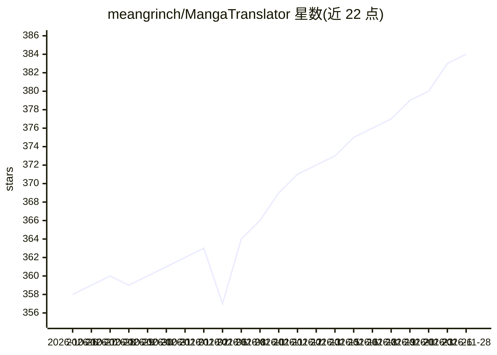

# meangrinch/MangaTranslator

⭐ 384 · Python · Apache-2.0 · 推送 2026-11-18 · [GitHub](https://github.com/meangrinch/MangaTranslator) · 个人维护 · 中文 README

**一键翻译漫画/韩漫/国漫页面的 AI 应用**

基于 ML 模型的漫画翻译桌面/命令行应用：检测气泡内与气泡外文本（YOLO、SAM），用扩散模型修复去除原文，经 OCR 与 LLM 翻译后按 60+ 语言重新排版。提供 Gradio Web UI 与 CLI 两种界面，支持单图、文件夹与 ZIP/CBZ 批量处理，附带超分辨率与自定义字体渲染。Windows 提供免安装包，Linux/macOS 或全部平台可从源码运行（Python 3.11+），翻译需配置云端 LLM API key 或本地 OpenAI 兼容端点。

## 筛选速览

| 维度 | 判定 | 备注 |
|---|---|---|
| AI 角色 | `ai-native` | 本体是模型或模型工具 |
| 许可风险 | `permissive` | Apache-2.0 |
| 部署形态 | `library` | 以包/库形式分发 |
| 模型依赖 | — | README 未给出锁定关系 |
| 硬件要求 | — | 无带数字的原话,不猜 |
| 安装摩擦 | `low` | 无编译、无系统依赖或容器化 |
| 成熟度 | — | 结构信号不足 |

## 能力要点

- 一键翻译漫画页，覆盖气泡内外文本检测（YOLO/SAM 2.1/3）
- 扩散模型修复去字（Fibo、FLUX 系列等六种选项）
- OCR+LLM 翻译 60+ 语言，支持云端 API 或本地 LLM 端点
- Web UI 与 CLI 双界面，支持 ZIP/CBZ 批量与仅清洁模式

## 适用场景

- 一键翻译日漫/韩漫/国漫页面生成可读版本
- 扫描组批量处理整话 ZIP/CBZ 并保留目录结构
- 仅去字不翻译，用于手动嵌字流程

## 场景标签

`图像视频处理` · 领域:感知与多模态

## 证据(README 行号)

> L9: One-click app that translates manga, manhwa, manhua, and comics using ML models. Targets both speech bubbles and out
> L63: - **Translation**: OCR and translation supporting 60+ languages (cloud API or local LLM)

## 星数曲线

2026-10-26 358 → 2026-11-28 384（+26）

---
*卡片 v1 · prompt 1.4 · 生成 2026-11-26 · 置信度 high · 依据 README sha `8cb4aa9c57df` · [字段定义](../../DATASET.md)*
