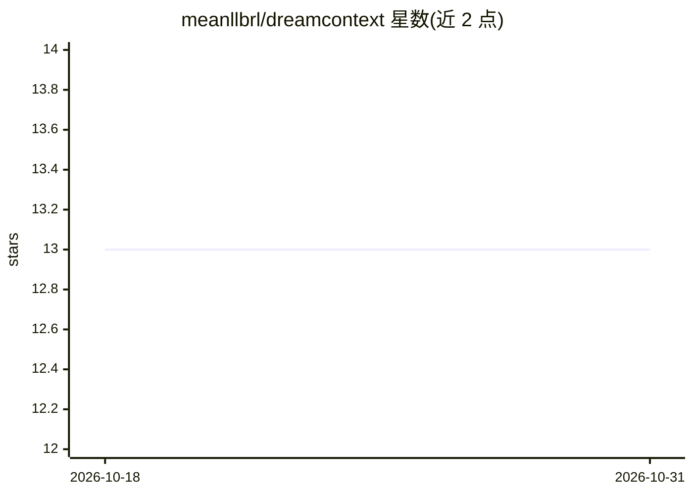

# meanllbrl/dreamcontext

⭐ 13 · TypeScript · Apache-2.0 · 推送 2026-10-29 · [GitHub](https://github.com/meanllbrl/dreamcontext) · 个人维护

**让 Claude/agent 以文件为“大脑”运行整个项目的 CLI 记忆层**

面向把项目全过程跑在 AI agent 上的创始人和小团队：以本地 markdown/JSON 文件构建 _dream_context/ 结构化上下文，含知识库、PRD、任务与路线图、指标、白板、多人格辩论与团队同步。核心机制是 Capture（7 个 hook 自动记录）→ Sleep（agent 并行蒸馏为人类可读文件）→ Start ready（下个会话预加载上下文）。当前支持 Claude Code，声明 agent 无关设计；处于 v1.0 前活跃开发阶段，API 与命令可能变更。安装经 curl 脚本或 npm，需 Node.js ≥ 18。

## 筛选速览

| 维度 | 判定 | 备注 |
|---|---|---|
| AI 角色 | `ai-ecosystem` | LLM/agent 周边工具 |
| 许可风险 | `permissive` | Apache-2.0 |
| 部署形态 | `desktop` | 安装包/桌面程序 |
| 模型依赖 | locked-api |  |
| 硬件要求 | — | 无带数字的原话,不猜 |
| 安装摩擦 | `low` | 无编译、无系统依赖或容器化 |
| 成熟度 | `idea` | |

## 能力要点

- 7 个 hook 自动捕获决策/约束，SessionStart 前注入全量上下文
- Sleep 机制：三个并行专家 agent 将会话蒸馏为人类可读文件
- 知识/PRD/任务/指标/白板/Council 多表面共用同一记忆引擎
- 数据全部为本地 git 跟踪的 markdown/JSON，可用 Obsidian 打开为知识图谱

## 适用场景

- 让 Claude Code 每次会话免重复探索代码库直接开工
- 维护团队始终新鲜的 PRD、路线图与指标文档
- 通过 git 同步把项目全貌共享给团队与各 agent

## 场景标签

`Agent 记忆` `知识库管理` · 领域:Agent 开发

## 证据(README 行号)

> L13:  Works with Claude Code today. Built agent-agnostic.
> L56: - **Capture** — while you work, hooks and bookmarks record what matters — decisions, constraints, discoveries — wit
> L115: > Requires **Node.js >= 18**. Currently supports **Claude Code**.

## 星数曲线

2026-10-18 13 → 2026-10-31 13（+0）

---
*卡片 v1 · prompt 1.4 · 生成 2026-10-31 · 置信度 high · 依据 README sha `187765b31b8a` · [字段定义](../../DATASET.md)*
