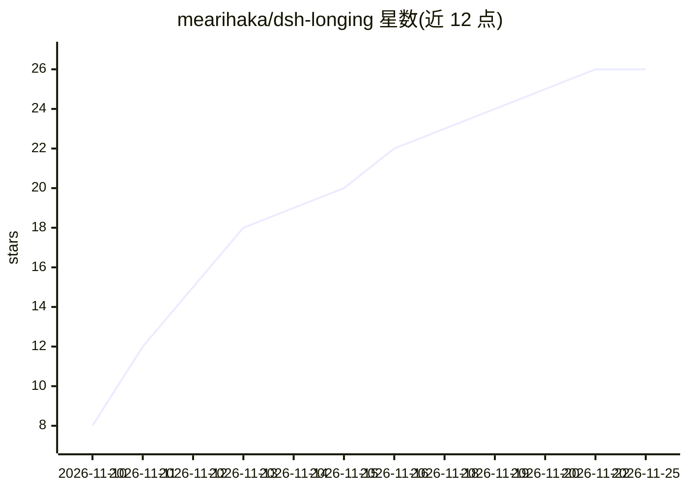

# mearihaka/dsh-longing

⭐ 26 · JavaScript · MIT · 推送 2026-11-21 · [GitHub](https://github.com/mearihaka/dsh-longing) · 个人维护 · 中文 README

**为 DSH 聊天机器人维护七维欲望状态机并注入给模型的插件**

DSH 框架的 TypeScript 插件：维护性欲/色情/占有/羞耻/理智/疲劳/好感七个 0–100 维度及其耦合关系，由 23 类对话事件推动、按半衰期回落到日常值，每分钟渲染成注入文本供 LLM 读取，并提供带令牌保护的本地网页面板与模型可调用的 longing 工具。默认不联网、不生成内容、成人内容开关默认关；通道（QQ/B站/网页）与 ComfyUI 生图均为可选外接。安装需 git clone 源码并挂进 profile 的 bundles。

## 筛选速览

| 维度 | 判定 | 备注 |
|---|---|---|
| AI 角色 | `ai-ecosystem` | LLM/agent 周边工具 |
| 许可风险 | `permissive` | MIT |
| 部署形态 | `desktop` | 安装包/桌面程序 |
| 模型依赖 | — | README 未给出锁定关系 |
| 硬件要求 | — | 无带数字的原话,不猜 |
| 安装摩擦 | `low` | 无编译、无系统依赖或容器化 |
| 成熟度 | — | 结构信号不足 |

## 能力要点

- 七维 0–100 状态互相牵制（占有压理智、疲劳压性欲等），带软上限与半衰期回落
- 23 个对话事件改值，含余怨（压 1–3 天）、一次性「第一次」事件、事后余韵
- 每分钟生成分通道注入文本，同时挂载 globalThis 变量供通道插件读取
- 本地网页面板：滑块调值、预设、24 小时曲线、108 项 schema 配置，接口仅绑回环并需令牌

## 适用场景

- 给 DSH 上的聊天角色加一层随时间与对话演化的数值状态
- 通过网页面板观察和调整角色状态曲线与主动行为参数
- 为自写的通道插件提供注入块、事件回报与主动开口的门控接口

## 场景标签

 · 领域:聊天机器人/角色扮演插件

## 证据(README 行号)

> L11: 不绑定任何平台：它只维护状态、渲染文本、提供一个面板。谁发消息，是你通道插件的事。
> L48: 不生成内容、不替你绕过任何模型的安全策略、不自己发消息、不假装能测量真实情绪。它只是一个状态机 + 一段注入文本。
> L69: |注入块|每分钟生成 `欲望注入.txt` + 每通道一份，同时挂在 `globalThis.__dshDesireBlocks`|

## 星数曲线

2026-11-10 8 → 2026-11-25 26（+18）

---
*卡片 v1 · prompt 1.4 · 生成 2026-11-18 · 置信度 high · 依据 README sha `d9cbd8c0f136` · [字段定义](../../DATASET.md)*
