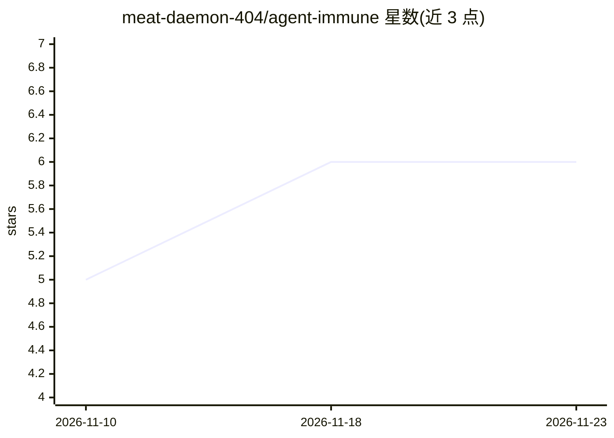

# meat-daemon-404/agent-immune

⭐ 6 · TypeScript · MIT · 推送 2026-11-22 · [GitHub](https://github.com/meat-daemon-404/agent-immune) · [官网](https://www.npmjs.com/package/dsh-immune-system) · 个人维护 · 中文 README

**为编码 agent 记录并拦截重复踩坑的免疫记忆插件**

面向 Claude Code、Cursor、Codex CLI 等编码 agent 的失败修复记忆工具：当工具调用失败后经修复，引擎将经验提炼为打分、脱敏的 antibody（trigger→avoid→do），存入本地 node:sqlite+FTS5，并在下次会话同类工具执行前注入 immune_memory 提示。一个 core 引擎通过 connect 命令接入 13 类 agent/CI 表面，含 GitHub Action PR 检查、pre-commit 钩子、团队规则同步、SVG 记分卡与本地离线仪表盘；零运行时依赖，100% 离线、无遥测。

## 筛选速览

| 维度 | 判定 | 备注 |
|---|---|---|
| AI 角色 | `ai-ecosystem` | LLM/agent 周边工具 |
| 许可风险 | `permissive` | MIT |
| 部署形态 | `desktop` | 安装包/桌面程序 |
| 模型依赖 | — | README 未给出锁定关系 |
| 硬件要求 | — | 无带数字的原话,不猜 |
| 安装摩擦 | `low` | 无编译、无系统依赖或容器化 |
| 成熟度 | — | 结构信号不足 |

## 能力要点

- 失败→修复的工具调用自动提炼为 antibody 并存入 SQLite+FTS5
- 一条 connect 命令接入 13 类 agent 与 CI 表面（含 MCP 21 工具）
- immune compile-rules 可将抗体转译为 Cursor/Copilot/Windsurf/Cline/CLAUDE.md 五种规则格式
- 离线仪表盘、SVG 记分卡与 3 行 GitHub Action PR 门禁

## 适用场景

- 避免 agent 在新会话重复踩已修复过的坑
- 团队间同步经过验证的踩坑规则（.immune/rules.jsonl）
- 统计 agent 重复错误被拦截后节省的 token 与时间

## 场景标签

`Agent 记忆` · 领域:Agent 开发

## 证据(README 行号)

> L20: **agent-immune** (`npm: dsh-immune-system`) is a zero-dependency **self-evolving immune memory for coding agents**.
> L22: One shared `core/` engine powers **13 agent & CI surfaces**: one-command `connect` for **Claude Code**, **Cursor**,

## 星数曲线

2026-11-10 5 → 2026-11-23 6（+1）

---
*卡片 v1 · prompt 1.4 · 生成 2026-11-20 · 置信度 high · 依据 README sha `4f45072eb76e` · [字段定义](../../DATASET.md)*
