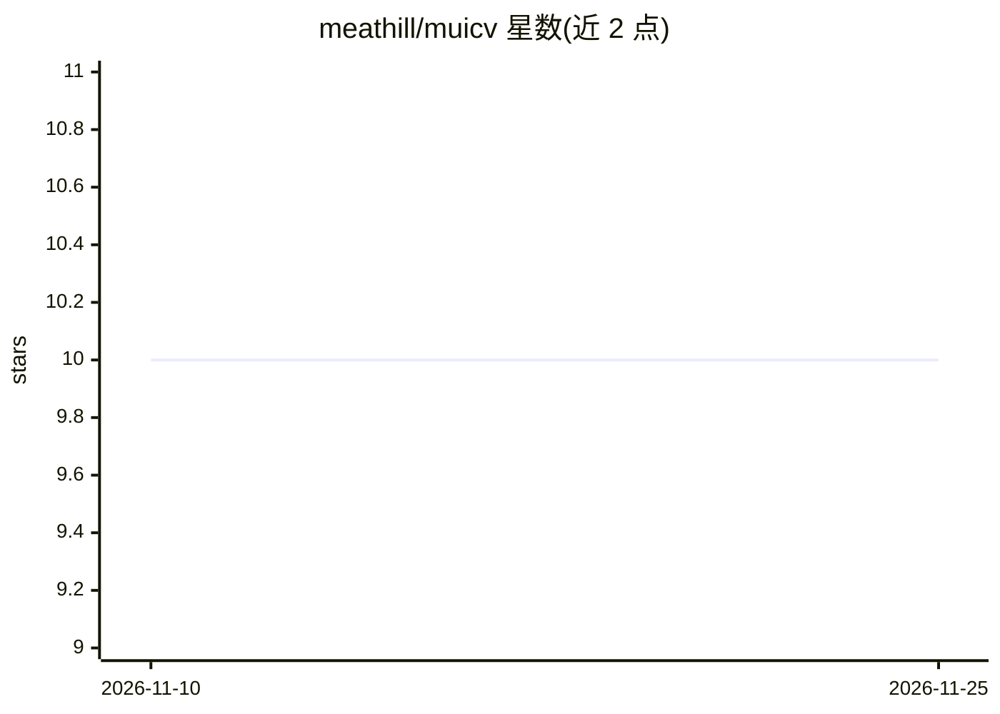

# meathill/muicv

⭐ 10 · TypeScript · 推送 2026-11-21 · [GitHub](https://github.com/meathill/muicv) · [官网](https://muicv.com) · 个人维护 · 中文 README

**在 AI agent 里管理简历素材并生成求职简历的技能集**

以 Claude Skill 规范编写的简历/求职技能集：简历素材以 Markdown + YAML frontmatter 存于用户本地目录、由 git 管理；通过 muicv-core 初始化与整理素材、muicv-generate 针对目标 JD 生成定制简历版本、muicv-critique 按 STAR/量化/关键词等维度评审、muicv-render 调服务端 API 渲染 PDF、muicv-jobs 抓取 JD 并做匹配分析与生成 cover letter。面向使用 AI agent 的求职者。当前处于重构中，从 chatbot web 应用转向 Skills + API 形态，许可证为 UNLICENSED。

## 筛选速览

| 维度 | 判定 | 备注 |
|---|---|---|
| AI 角色 | `ai-native` | 本体是模型或模型工具 |
| 许可风险 | `none` | — |
| 部署形态 | `desktop` | 安装包/桌面程序 |
| 模型依赖 | — | README 未给出锁定关系 |
| 硬件要求 | — | 无带数字的原话,不猜 |
| 安装摩擦 | `low` | 无编译、无系统依赖或容器化 |
| 成熟度 | `idea` | |

## 能力要点

- 素材以 Markdown + YAML 存本地目录，由用户自持 git 管理
- 5 个 Skill：素材管理、按 JD 生成、多维评审、PDF 渲染、JD 抓取与匹配
- skills CLI 安装，兼容 Claude Code / Codex / Cursor / OpenCode 等 40+ agent
- 另有 Electron 桌面应用（.dmg），LLM 走 OpenAI 兼容的 muirouter

## 适用场景

- 在 Claude Code 里用对话维护和整理我的工作经历素材
- 针对某个岗位 JD 从素材库生成一份定制简历
- 让 AI 按 STAR/量化/关键词等维度评审我的简历
- 抓取 JD 分析匹配度并生成求职信

## 场景标签

`AI 写作` · 领域:内容生成

## 证据(README 行号)

> L3: > 在你熟悉的 AI agent（Claude Code / Codex / Cursor ...）里管理简历。
> L5: 简历素材以 **Markdown + YAML frontmatter** 存在你自己的项目目录里，由你用 git 管理；针对不同岗位生成的简历版本也同样存本地。服务端只承担本地不方便做的事：PDF 渲染、JD 抓取、模板库，以及后
> L47: |`muicv-core`|✅ 已实现|初始化、添加 / 更新 / 整理素材|

## 星数曲线

2026-11-10 10 → 2026-11-25 10（+0）

---
*卡片 v1 · prompt 1.4 · 生成 2026-11-19 · 置信度 high · 依据 README sha `4613861a3bc3` · [字段定义](../../DATASET.md)*
