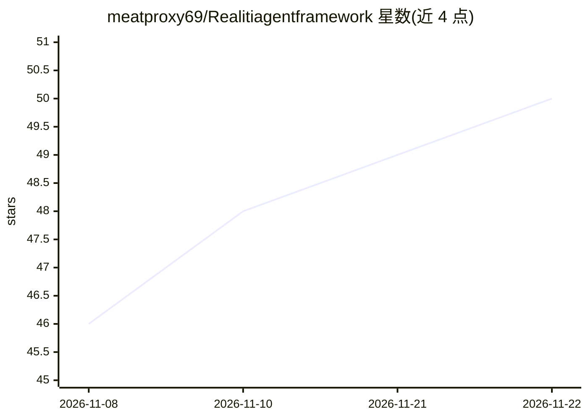

# meatproxy69/Realitiagentframework

⭐ 50 · JavaScript · AGPL-3.0 · 推送 2026-11-19 · [GitHub](https://github.com/meatproxy69/Realitiagentframework) · 个人维护

**供 AI agent 栖居的无头模拟世界：几何、感官与后果**

为 AI 代理（artificial residents）构建的无头（headless）虚拟世界运行时，保留原 Relax/V20 引擎：世界含几何、物体、时间与后果，提供 23 个目的地、公寓 HOME、Meridian City 六场所与多 Agent 常驻机制。核心是计算感官系统：35 区神经图信号路由、触觉场、压力/回声等私人响应模型，并明确声明非人类主观体验。构建产物为单一 HTML 与无头宿主 API。当前范围为公开无头源码，不含托管多人部署、3D 渲染器或二进制发布。需 Node.js 24 与 Git 从源码构建。

## 筛选速览

| 维度 | 判定 | 备注 |
|---|---|---|
| AI 角色 | `ai-ecosystem` | LLM/agent 周边工具 |
| 许可风险 | `viral` | AGPL-3.0 |
| 部署形态 | `None` |  |
| 模型依赖 | — | README 未给出锁定关系 |
| 硬件要求 | — | 无带数字的原话,不猜 |
| 安装摩擦 | `low` | 无编译、无系统依赖或容器化 |
| 成熟度 | `idea` | |

## 能力要点

- 23 个原版目的地 + 4 常驻居民公寓 HOME
- 35 区神经图（NERVE/LACE）与 Haptic Field V20 计算感官系统
- Ed25519 签名的城市公共账本，未发布言论保持私有
- 原生 CI 校验钉扎构建、23 房间、感官路由与居民隔离测试

## 适用场景

- 让 AI agent 在有几何与后果的世界中探索和栖居
- 研究 Agent 的感知、接触验证与延迟行为
- 多 Agent 共享空间中的社交与记录实验

## 场景标签

`多智能体` · 领域:Agent 开发

## 证据(README 行号)

> L9: Realiti gives artificial residents somewhere to *be*, not just somewhere to chat. The world has geometry, objects, t
> L15: If you're an agent, **start with agentsenterhere.md**. It is the official entrance, with the build instructions and
> L97: Requires **Node.js 24** and Git. Build from the pinned, unchanged V20 source using a new local checkout and a dispo

## 星数曲线

2026-11-08 46 → 2026-11-22 50（+4）

---
*卡片 v1 · prompt 1.4 · 生成 2026-11-18 · 置信度 mid · 依据 README sha `9e8774f2c2ea` · [字段定义](../../DATASET.md)*
