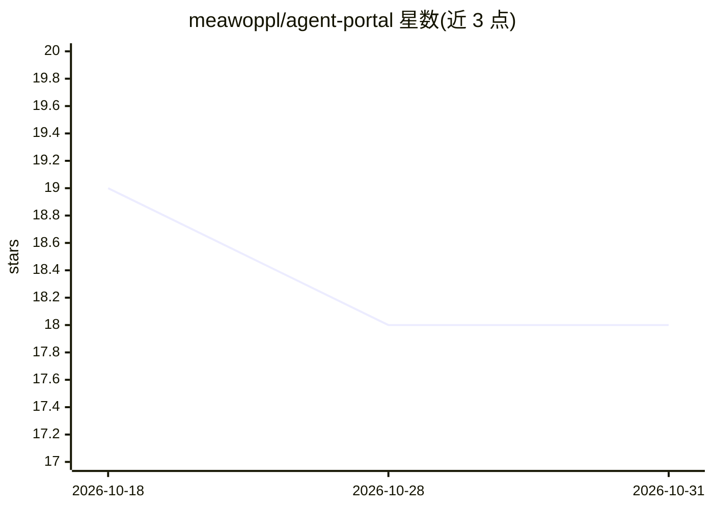

# meawoppl/agent-portal

⭐ 18 · Rust · 推送 2026-10-30 · [GitHub](https://github.com/meawoppl/agent-portal) · [官网](https://txcl.io) · 个人维护

**在自有机器上运行编程 agent 并从浏览器远程操控的门户**

Rust 实现的 agent 会话门户：在每台机器部署常驻 launcher 守护进程，连接自托管或官方托管的服务端，通过 Web UI（Yew/WebAssembly）在手机、平板、桌面间实时查看与操控 agent 会话，含断线恢复、转录与成本留存。支持 Claude Code、OpenAI Codex、Meta Muse Code 三种 agent CLI，提供端口转发、会话间消息与工作队列、定时任务、按会话的 token/成本指标、插件系统（KiCad/Verilog/CAD 等）与语音输入。可使用托管服务 txcl.io 或 git clone 后本地运行。

## 筛选速览

| 维度 | 判定 | 备注 |
|---|---|---|
| AI 角色 | `ai-ecosystem` | LLM/agent 周边工具 |
| 许可风险 | `none` | — |
| 部署形态 | `None` |  |
| 模型依赖 | — | README 未给出锁定关系 |
| 硬件要求 | — | 无带数字的原话,不猜 |
| 安装摩擦 | `low` | 无编译、无系统依赖或容器化 |
| 成熟度 | — | 结构信号不足 |

## 能力要点

- 一台仪表盘管理 Claude Code / Codex / Muse 三种 agent CLI，各自协议渲染
- 跨设备实时会话：断线重连不丢转录，Web 输入带幂等键
- 会话间消息与工作队列，支持 agent 间协作模式
- 端口转发（WebSockets/SSE 可穿透）、定时任务、插件运行时与按轮成本指标

## 适用场景

- 把工作站的编程 agent 会话交给手机或笔记本随时接管
- 在多个自有机器上部署并统一管理编程 agent
- 让一个 agent 写代码、另一个 agent 审查并互发消息协作

## 场景标签

`编码 Agent` `多智能体` · 领域:Agent 开发

## 证据(README 行号)

> L3: Run coding agents on your own machines and drive them from any browser.
> L15: Supported agents: **Claude Code**, **OpenAI Codex**, and **Meta Muse Code**

## 星数曲线

2026-10-18 19 → 2026-10-31 18（-1）

---
*卡片 v1 · prompt 1.4 · 生成 2026-10-29 · 置信度 high · 依据 README sha `b5612f571d07` · [字段定义](../../DATASET.md)*
